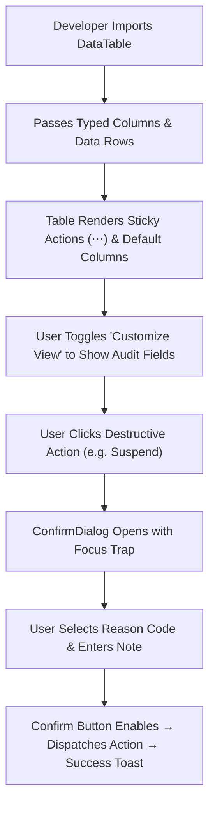

# Product Requirements Document (PRD)
## Sprint 0: Design System & Core UI Atoms

---

### 1. Document Control & Metadata
- **Document Title:** Product Requirements Document - Sprint 0: Design System & Core UI Atoms
- **Document Version:** 1.0.0
- **Status:** Approved / Completed
- **Author:** CICOD Product & Engineering Team
- **Target Sprint:** Sprint 0 (Week 1)
- **Target Audience:** Frontend Engineers, UI/UX Designers, QA Automation Engineers
- **Reference Standard:** [cicod_premium_styleguide.html](file:///c:/Users/CI-STAFF/Documents/CICOD%20TEST/Cicod%20Design%20Systems/cicod_premium_styleguide.html)
- **Last Updated:** 2026-10-13

---

### 2. Executive Summary & Core Deliverables
The legacy CRM (`internal.cicod.com/crm`) suffered from extreme visual and structural drift: every page re-invented buttons, tables, badges, and modals. Destructive operations used safe green styling, and tables with 13+ columns spilled off 1440px viewports with clipped action menus.

Sprint 0 establishes the unshakeable design system foundation in Next.js (`src/components/ui/`, `src/components/layout/`, and `src/app/globals.css`). It translates `cicod_premium_styleguide.html` into reusable CSS tokens, accessible interactive atoms, and a universal data table harness.

#### Core Deliverables
1. **Design Token Engine (`globals.css`):** Signal Primary, Ink Secondary, Paper background, and semantic alert variables synchronized across light and dark modes.
2. **Accessible Presentation Atoms:** `Button`, `StatusBadge`, `HealthBadge`, `SwitchRow`, `Select`, `Input`, and `Modal`.
3. **Universal Data Table Harness:** `DataTable<T>` with virtualized scrolling, sticky actions column (48px), column visibility chooser ("Customize View"), and windowed numeric `Pagination` (`1 2 3 … 10`).
4. **Safe Action Modals:** `ConfirmDialog` requiring reason capture before executing destructive tenant or user mutations.

---

### 3. Product Vision & Strategic Objectives
- **Zero Style Duplication:** Eliminate ~2,500 lines of boilerplate across 7 list views by establishing a single source of truth for UI components.
- **Visual Excellence & Brand Identity:** Ensure the CRM adheres strictly to CICOD's premium design aesthetic (Sora headings, Inter body, Signal amber `#F2A93B`, Ink navy `#12253F`).
- **Defensive User Experience:** Ensure destructive actions (suspensions, deletions, key revocations) are visually distinct, guarded by confirmations, and require structured audit reasons.

---

### 4. Target Audience & User Personas
- **CRM Operations Specialist:** Spends 8+ hours/day navigating high-density tables; requires high contrast, zero layout shifts, and predictable sticky action menus.
- **Frontend Engineer:** Consumes strictly typed, reusable React 19 primitives with zero CSS leakage or layout quirks.
- **Accessibility & Compliance Auditor:** Requires WCAG 2.1 AA contrast compliance, keyboard navigability (`Tab`, `Esc`, `Enter`), and screen-reader compliant ARIA landmarks.

---

### 5. Scope Boundaries

#### 5.1 In-Scope
- CSS variable token system supporting light and dark themes.
- Typography engine loading Google Fonts `Sora` and `Inter`.
- Atomic UI primitives: `Button` (5 variants, 4 sizes), `StatusBadge` (soft pill status/health variants), `SwitchRow` (toggle with left-0 knob alignment).
- Compound table harness: `DataTable<T>`, `FilterBar` (omni-search + segment selector), and windowed `Pagination`.
- Accessible dialog primitives: `Modal` (focus trapped) and `ConfirmDialog` (mandatory reason capture).

#### 5.2 Out-of-Scope
- Backend database migrations and live REST endpoint integrations (deferred to Sprint 8).
- Domain-specific business logic (Customer 360, Billing algorithms, Dunning cron jobs).
- Complex canvas or drag-and-drop workflow builders (Campaign Studio).

---

### 6. Comprehensive User Flow & Journey Maps

#### 6.1 Primary Happy Path Flow


#### 6.2 Alternate & Exception Flows
- **Zero Results / Empty State:** When filtered data returns 0 rows, `DataTable` displays an empty state card with an illustrative icon, contextual message, and "Reset Filters" action.
- **Network / Rendering Error:** Component wraps inside a React Error Boundary; renders a graceful error tile with a "Try Again" retry trigger.
- **Modal Dismissal:** Pressing `Esc` or clicking the backdrop dismisses `ConfirmDialog` without triggering any mutation.

---

### 7. Functional Requirements (FRs)

| ID | Module / Atom | Requirement Description | Acceptance Standard |
|---|---|---|---|
| **FR-001** | Tokens & Theme | Implement light/dark CSS variables in `globals.css` covering Paper, Ink, Signal, and Semantic tokens. | Seamless theme transition without unstyled flashes or contrast loss. |
| **FR-002** | Typography | Load Google Fonts `Sora` (headings: 600, 700, 800) and `Inter` (body: 400, 500, 600). | Default browser serif/sans-serif fonts are completely overridden. |
| **FR-003** | Button Atom | Provide 5 variants: `default` (amber), `secondary` (navy), `outline`, `destructive`, `ghost`; 4 sizes (`sm`, `default`, `lg`, `icon`). | Focus rings conform to `--ring: #F2A93B` with 2px offset. |
| **FR-004** | Status & Health | Render soft badge pills with colored dot indicators for: `Active`, `Draft`, `Live`, `Archived`, `Healthy`, `Trial`, `Due Soon`, `Overdue`, `Suspended`. | Text contrast ≥ 4.5:1 against tinted badge background. |
| **FR-005** | SwitchRow | Accessible toggle switch where the entire card is clickable; knob anchored strictly to `left-0`. | Knob starts at 4px left when OFF (`translate-x-1`) and 4px right when ON (`translate-x-6`). |
| **FR-006** | DataTable | Reusable table component accepting generic row types, supporting sticky actions, sorting, and responsive truncation. | Actions column remains pinned to right edge (48px) across all scroll states. |
| **FR-007** | FilterBar | Omni-search input with instant clear, 250ms debounce, and URL query parameter synchronization. | Typing in search reflects in URL search params (`?q=...`) without page reload. |
| **FR-008** | Pagination | Windowed numeric pagination displaying `"Showing X to Y of Z results"` with rows per page selector. | Displays `1 2 3 … 10` format, eliminating legacy 134-button pager bug. |
| **FR-009** | ConfirmDialog | Modal for destructive mutations with optional required reason dropdown and explanation notes. | Confirm button stays disabled until reason is selected if `requireReason=true`. |

---

### 8. Non-Functional Requirements (NFRs)

#### 8.1 Performance & Latency
- `DataTable` renders 100 rows in < 16ms frame budget (60 FPS scrolling).
- Token switching between light and dark modes executes in < 5ms without cumulative layout shift (CLS < 0.05).

#### 8.2 Security & Compliance
- Form inputs sanitize string inputs against XSS attacks before state binding.
- Destructive operations strictly require user confirmation to prevent accidental data loss.

#### 8.3 Reliability & Availability
- All UI components wrapped in error boundaries to isolate component-level failures.
- Zero external runtime script dependencies (icons bundled via `lucide-react`).

#### 8.4 Usability & Accessibility
- WCAG 2.1 AA compliance: Text contrast ratio ≥ 4.5:1; interactive UI contrast ≥ 3.0:1.
- Full keyboard operability: `Tab` for focus navigation, `Space`/`Enter` to toggle switches/buttons, `Esc` to close modals.

---

### 9. Detailed User Stories & Acceptance Criteria

#### User Story 0.1: Accessible Toggle Switch
*As a CRM operator, I want toggle switches to visually align inside their pill track so that I can immediately discern whether a policy or setting is ON or OFF.*
- **Given** a `SwitchRow` rendered on any form,
- **When** the switch state is `false` (OFF),
- **Then** the white knob is positioned exactly 4px from the left edge (`translate-x-1` from `left-0`).
- **When** the switch state is `true` (ON),
- **Then** the white knob is positioned exactly 4px from the right edge (`translate-x-6` from `left-0`), contained within the 44px track without spilling over.

#### User Story 0.2: Windowed Table Pagination
*As a support specialist, I want predictable pagination buttons so that I can navigate large datasets without 134 buttons cluttering the screen.*
- **Given** a dataset of 13,355 customer records in `DataTable`,
- **When** the user views page 1,
- **Then** the pager shows `1 2 3 … 535` with Prev/Next buttons.
- **When** the user changes rows per page from 10 to 25,
- **Then** the total page count recalculates to 535 and page 1 is preserved.

#### User Story 0.3: Destructive Action Safety Gate
*As an operations supervisor, I want destructive actions to mandate reason logging so that accidental suspensions or deletions are prevented.*
- **Given** a user clicks "Suspend Customer" in any row menu,
- **When** the `ConfirmDialog` opens,
- **Then** the "Confirm Suspension" button is disabled until a reason code is selected and a note is entered.

---

### 10. Technical Architecture & Data Models

#### Component Hierarchy
```
src/
├── app/
│   ├── globals.css                # Master CSS variables (Paper & Ink palette)
│   └── layout.tsx                 # Root layout loading Sora & Inter fonts
├── components/
│   ├── ui/
│   │   ├── Button.tsx             # Shared button primitive with variants
│   │   ├── StatusBadge.tsx        # Semantic pill status and health badges
│   │   ├── ConfirmDialog.tsx      # Safe destructive modal with reason validation
│   │   ├── Modal.tsx              # Focus-trapped dialog primitive
│   │   ├── Select.tsx             # Accessible listbox dropdown
│   │   └── Toast.tsx              # Notification toast system
│   └── layout/
│       ├── DataTable.tsx          # Universal table with sticky actions
│       ├── FilterBar.tsx          # Omni-search + segment pills + URL sync
│       └── Pagination.tsx         # Windowed pager (1 2 3 ... 10)
```

---

### 11. Edge Cases & Error Handling Strategies
- **Text Overflow:** Primary table cells enforce `truncate` with `title` attributes for tooltips on overflow.
- **Empty Datasets:** Tables render friendly empty states with actionable CTA rather than blank screens.
- **Rapid Clicking / Debounce:** Search inputs debounce queries at 250ms; action buttons disable upon click to prevent double submissions.

---

### 12. Success Metrics & Key Performance Indicators (KPIs)
- **Code Reduction:** Eliminate ≥ 2,500 lines of redundant table and modal boilerplate across the app.
- **A11y Score:** Lighthouse Accessibility audit score ≥ 95 on all UI components.
- **Zero Style Regressions:** 0 reported button overflow or knob alignment issues across Chrome, Firefox, Safari, and Edge.

---

### 13. Release Plan, Milestones & Rollout Strategy
- **Day 1-2:** Tokens, typography, and basic atom components (`Button`, `StatusBadge`, `SwitchRow`).
- **Day 3-4:** Data table harness (`DataTable`, `FilterBar`, `Pagination`).
- **Day 5:** Modal primitives (`Modal`, `ConfirmDialog`, `Toast`) and automated visual regression checks.

---

### 14. Open Questions, Risks & Dependencies
- **Risk:** Developers manually writing ad-hoc inline styles instead of using design tokens.
  - *Mitigation:* Strict ESLint rules and PR checklist enforcing design system components.
- **Dependency:** Google Fonts CDN accessibility.
  - *Mitigation:* Self-hosted fallback font family stacks in `globals.css`.
