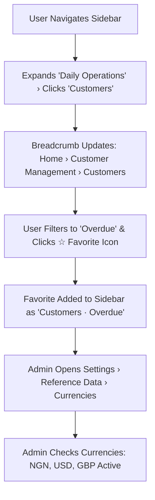

# Product Requirements Document (PRD)
## Sprint 1: App Shell, Navigation & Reference Data

---

### 1. Document Control & Metadata
- **Document Title:** Product Requirements Document - Sprint 1: App Shell, Navigation & Reference Data
- **Document Version:** 1.0.0
- **Status:** In Progress
- **Author:** CICOD Product & Architecture Team
- **Target Sprint:** Sprint 1 (Week 2)
- **Target Audience:** Frontend Engineers, Backend Architects, Operations Leads, System Administrators
- **Reference Code:** [nav.ts](file:///c:/Users/CI-STAFF/Documents/CICOD%20TEST/Cicod%20CRM/src/lib/nav.ts), [ReferenceView.tsx](file:///c:/Users/CI-STAFF/Documents/CICOD%20TEST/Cicod%20CRM/src/app/crm/settings/components/ReferenceView.tsx)
- **Last Updated:** 2026-10-13

---

### 2. Executive Summary & Core Deliverables
The legacy CRM navigation contained 8 arbitrary top-level sections, including top-level menu entries for 1-record tables (`Product Types`) and 4-record reference lists (`Service Types`). Breadcrumbs were hard-coded to "Home › Customer Mgt › Customers" across all pages, and 8 separate Business Setup pages held uncurated lists of 119 currencies and 251 countries.

Sprint 1 delivers a clean two-level application shell with a collapsible sidebar (260px → 72px), route-computed dynamic breadcrumbs, a user favorites bar, and a centralized Reference Data hub under Settings.

#### Core Deliverables
1. **Collapsible 2-Level Sidebar:** Grouped by high-level job functions: Daily Operations, Growth, Campaign Studio, Administration.
2. **Dynamic Header & Breadcrumb Engine:** Route-derived breadcrumb hierarchy with entity names and quick search.
3. **Favorites Manager:** Star any page or filtered view into the sidebar with `localStorage` persistence.
4. **Unified Reference Data Hub (`/crm/settings/reference`):** Tabbed management for Currencies, Operating Locations, Sectors & Types, and Payment Channels.
5. **Catalogue Setup Relocation:** Relocate Service Types, Product Types, and Bundle Groups under Settings.

---

### 3. Product Vision & Strategic Objectives
- **Information Architecture Discipline:** Enforce a strict "two levels at most" rule; reference lists move to Settings.
- **Contextual Awareness:** Ensure every screen shows users exactly where they sit via live breadcrumbs.
- **Data Integrity & Protection:** Prevent operational errors by enforcing guard rails (e.g. currencies in active use cannot be disabled).

---

### 4. Target Audience & User Personas
- **System Administrator:** Curates trading currencies, operating locations, and business sectors across the tenant base.
- **Support & Operations Specialist:** Jumps rapidly between customer profiles and billing queues via bookmarked favorites.
- **Product Manager:** Needs certainty that changing reference data safely cascades to pricing and onboarding forms.

---

### 5. Scope Boundaries

#### 5.1 In-Scope
- Collapsible sidebar rail (260px expanded, 72px collapsed).
- Dynamic breadcrumb generation matching route prefixes in `src/lib/nav.ts`.
- User Favorites manager supporting starring, renaming, reordering, and deleting.
- Reference Data hub with Currencies, Locations (Country/State/LGA), Sectors/Types, and Payment Channels.
- Relocation of Service Types, Product Types, and Bundle Groups under Settings.

#### 5.2 Out-of-Scope
- External multi-tenant organization switching (single-org CRM focus).
- Live third-party currency exchange rate feed integrations (manual curation for trading stability).
- End-user customer portal navigation (internal staff console focus).

---

### 6. Comprehensive User Flow & Journey Maps

#### 6.1 Primary Happy Path Flow


#### 6.2 Alternate & Exception Flows
- **Attempting to Deactivate In-Use Currency:** User tries to switch off `NGN`; system checks active plan count, blocks toggle, and displays a warning toast ("NGN is used by 14 active plans and cannot be switched off").
- **Deep Entity Route Match:** When navigating to `/customers/23488`, breadcrumb resolves entity name to display `Home > Customer Management > Customers > crmdemo (#23488)`.
- **Collapsed Sidebar Usage:** User collapses sidebar to 72px; hover tooltips display full submenu items for immediate access.

---

### 7. Functional Requirements (FRs)

| ID | Module | Requirement Description | Acceptance Standard |
|---|---|---|---|
| **FR-101** | App Shell | Sidebar with 2 levels max; collapses from 260px to 72px with floating hover submenus. | Collapse state persists in localStorage; smooth transition. |
| **FR-102** | Breadcrumbs | Dynamic breadcrumbs derived from active route matching against `nav.ts` hierarchy. | Detail routes render entity name instead of raw token. |
| **FR-103** | Favorites | Header star icon toggles active page/filters into sidebar Favorites list. | Starred items open with preserved URL query parameters. |
| **FR-104** | Currencies | Curate trading currencies (NGN, USD, GBP, EUR) with active switches. | Currencies used by live plans cannot be switched off. |
| **FR-105** | Locations | Hierarchical Country → State → LGA management with completeness indicators. | Only operational countries enabled; LGAs drill down in place. |
| **FR-106** | Sectors & Types | Parent Sector to child Business Types mapping with inline creation. | Sectors with active tenants cannot be deleted or disabled. |
| **FR-107** | Payment Channels | Configure online (Card) vs. offline methods (Bank Transfer, Cash) and reference requirements. | Offline methods configure whether bank reference is mandatory. |
| **FR-108** | Catalogue Setup | Relocate Service Types, Product Types, and Bundle Groups under Settings. | Removed from primary root sidebar; accessible under Settings. |

---

### 8. Non-Functional Requirements (NFRs)

#### 8.1 Performance & Latency
- Sidebar route transitions complete in < 50ms using Next.js Link prefetching.
- Reference data lists load in < 150ms without layout jump.

#### 8.2 Security & Compliance
- Reference data modifications restricted to staff with Administrator role privileges.
- All reference changes logged to the immutable system audit log.

#### 8.3 Reliability & Availability
- Navigation tree state remains resilient during deep linking and browser refresh.
- 99.9% availability of client-side routing.

#### 8.4 Usability & Accessibility
- WCAG 2.1 AA keyboard navigation: Tab focus through sidebar links; Esc closes expanded flyouts.
- High-contrast active link indicator (`bg-[var(--accent)] text-[var(--primary)]`).

---

### 9. Detailed User Stories & Acceptance Criteria

#### User Story 1.1: Dynamic Contextual Breadcrumbs
*As a support agent, I want the breadcrumb to reflect my exact location so that I never lose customer context when troubleshooting.*
- **Given** an agent opens `/crm/customer-mgt/customers/23488`,
- **When** the page renders,
- **Then** the breadcrumb reads `Home > Customer Management > Customers > crmdemo (#23488)`.

#### User Story 1.2: Guarded Currency Deactivation
*As a commercial lead, I want active billing currencies protected so that live subscriptions don't fail due to accidental reference changes.*
- **Given** `USD` is assigned to 6 live product offers,
- **When** an administrator attempts to toggle USD OFF in Reference Data,
- **Then** the toggle is blocked and a warning alert specifies the 6 active plans preventing deactivation.

#### User Story 1.3: Personalized Sidebar Favorites
*As a collections officer, I want to bookmark the 'Ready to Suspend' queue so that I can access my daily triage list with one click.*
- **Given** an officer filters Collections to `Ready to Suspend`,
- **When** they click the header star icon and save,
- **Then** "Collections · Ready to Suspend" appears in the sidebar Favorites and opens the exact filtered view upon click.

---

### 10. Technical Architecture & Data Models

#### Navigation Configuration (`src/lib/nav.ts`)
```typescript
export type NavLeaf = { label: string; href: string };
export type NavFolder = { label: string; children: NavLeaf[] };
export type NavGroup = { title: string; icon: ElementType; href?: string; children?: (NavLeaf | NavFolder)[] };
export type NavSection = { caption: string; groups: NavGroup[] };

export const NAV: NavSection[];
export function matchNav(pathname: string): NavMatch | undefined;
```

#### Target REST API Contracts
- `GET /api/v2/reference/currencies`: Returns list of currencies with plan usage counts.
- `PATCH /api/v2/reference/currencies/{code}`: Toggles currency active state.
- `GET /api/v2/reference/locations`: Returns country/state/LGA hierarchy.
- `GET /api/v2/reference/sectors`: Returns sectors with nested business types.
- `PATCH /api/v2/reference/payment-methods/{id}`: Toggles payment method rules.

---

### 11. Edge Cases & Error Handling Strategies
- **Deeply Nested Locations:** Lazy-load state and LGA lists on demand to prevent heavy initial payload.
- **Special Characters in Types:** Sanitize business type inputs to prevent HTML tag injection.
- **Storage Quota Exceeded:** Gracefully cap saved favorites at 20 items per user.

---

### 12. Success Metrics & Key Performance Indicators (KPIs)
- **Navigation Efficiency:** Average clicks to reach customer records reduced from 4 clicks to 1-2 clicks.
- **Reference Integrity:** 0 broken plan assignments due to disabled currencies or deleted sectors.
- **Sidebar Adoption:** ≥ 80% of daily active staff utilize at least 1 saved Favorite shortcut.

---

### 13. Release Plan, Milestones & Rollout Strategy
- **Milestone 1.1:** Navigation structure refactor (`nav.ts`) and dynamic breadcrumbs.
- **Milestone 1.2:** Favorites manager with local storage engine.
- **Milestone 1.3:** Reference Data hub with Currencies, Locations, and Sectors tabs.
- **Milestone 1.4:** Move Service Types, Product Types, and Bundle Groups to Settings.

---

### 14. Open Questions, Risks & Dependencies
- **Risk:** Regional differences in location naming (e.g. Nigerian LGAs vs UK Counties).
  - *Mitigation:* Flexible label column adapting based on parent country.
- **Dependency:** Reference data must be seeded and verified before customer onboarding forms can use live dropdowns.
