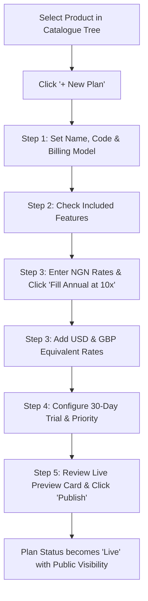

# Product Requirements Document (PRD)
## Sprint 2: Commercial Catalogue & Pricing Matrix

---

### 1. Document Control & Metadata
- **Document Title:** Product Requirements Document - Sprint 2: Commercial Catalogue & Pricing Matrix
- **Document Version:** 1.0.0
- **Status:** In Progress
- **Author:** CICOD Product & Architecture Team
- **Target Sprint:** Sprint 2 (Week 3)
- **Target Audience:** Commercial Directors, Product Managers, Billing Ops, Frontend & Backend Engineers
- **Reference Code:** [catalogue/page.tsx](file:///c:/Users/CI-STAFF/Documents/CICOD%20TEST/Cicod%20CRM/src/app/crm/catalogue/page.tsx), [PlanEditor.tsx](file:///c:/Users/CI-STAFF/Documents/CICOD%20TEST/Cicod%20CRM/src/app/crm/catalogue/components/PlanEditor.tsx), [BundleEditor.tsx](file:///c:/Users/CI-STAFF/Documents/CICOD%20TEST/Cicod%20CRM/src/app/crm/catalogue/components/BundleEditor.tsx)
- **Last Updated:** 2026-10-13

---

### 2. Executive Summary & Core Deliverables
The legacy commercial catalogue was fragmented across 7 disjointed tables (`Products`, `Product Captions`, `Bundle Groups`, `Single Offers`, `Bundles`, `Service Types`, `Product Types`). Modals omitted multi-currency pricing, feature checklists, and trial durations. About 25 of 35 single offers were duplicate or obsolete records ("Premium.", "Premium 1", "Standard Test"), and no screen visualized missing currency rates or protected public pricing from accidental one-click deletion.

Sprint 2 unifies the commercial catalogue into a master **Products & Plans Workspace**, a full-page **5-Step Plan Editor**, a **Bundle Editor**, and a **Global Pricing Gap Matrix**, enforcing strict lifecycle governance: `Draft → Live (Published) → Archived`.

#### Core Deliverables
1. **Two-Pane Products & Plans Workspace:** Product tree on left; plan comparison cards, status badges, and inline feature matrix on right.
2. **Full-Page 5-Step Plan Editor:** Dedicated flow covering Basics, Feature Checklist, Multi-Currency Pricing (NGN/USD/GBP), Trial/Extras, and Live Preview Review.
3. **Smart Pricing Matrix Automation:** "Fill Annual at 10×" quick action for annual billing calculation and mismatch validation warnings.
4. **Bundle Composition Studio:** Dynamic multi-product bundle composer with license/storage caps and automated savings calculation.
5. **Global Pricing Gap Matrix:** Cross-product audit grid highlighting missing international currencies and billing periods.
6. **Publishing & Archiving Safety Guard:** Blocking validations preventing plan archival if active customers or active bundles depend on it.

---

### 3. Product Vision & Strategic Objectives
- **Commercial Single Source of Truth:** Eliminate conflicting duplicate offers and create a coherent commercial definition for every tier.
- **Global Multi-Currency Readiness:** Enable frictionless expansion across NGN, USD, and GBP with transparent parity checks.
- **Revenue Protection:** Prevent breaking public checkouts or customer contracts by locking active plans from deletion.

---

### 4. Target Audience & User Personas
- **Commercial Product Manager:** Configures tiers, bundles, feature gates, and discount structures.
- **Sales Director / Account Executive:** Inspects real-time feature matrices, currencies, and bundle savings when pitching enterprise clients.
- **Billing Operations Lead:** Ensures all plans have configured periodic or usage rates before invoices generate.

---

### 5. Scope Boundaries

#### 5.1 In-Scope
- Master Products & Plans two-pane interface (`/crm/catalogue`).
- Inline product feature inventory and plan comparison matrix (✓ vs —).
- 5-step full-page plan editor (`/crm/catalogue/plans/new` and `/crm/catalogue/plans/[code]`).
- Multi-currency rate matrix (NGN base, USD, GBP) across Monthly and Annual intervals.
- "Fill Annual at 10×" automation and gap validation badges.
- Bundle editor with per-product single-plan constraint and bundle savings display (`/crm/catalogue/bundles`).
- Global pricing audit view (`/crm/catalogue/pricing`) with "Gaps Only" filter.
- Obsolete legacy offer archival behind collapsible drawer.

#### 5.2 Out-of-Scope
- Live real-time FX rate synchronization from external central banks (static merchant curation retained).
- Usage metering ingestion engine (covered in Sprint 4 Billing).
- Customer self-serve checkout payment flow (staff configuration console focus).

---

### 6. Comprehensive User Flow & Journey Maps

#### 6.1 Primary Happy Path Flow


#### 6.2 Alternate & Exception Flows
- **Annual Price Mismatch Warning:** If an admin enters a monthly price in USD ($50) but leaves annual USD empty, an amber badge displays: *"USD annual price missing"*.
- **Blocked Archival Attempt:** Admin attempts to archive the "Standard" plan. System queries customer subscriptions: *"1,204 customers are active on Standard. Cannot archive until customers are migrated."* The action is blocked.
- **Bundle Rule Violation:** In Bundle Editor, user attempts to select two plans from the same product. Interface restricts selection to radio behavior per product row.

---

### 7. Functional Requirements (FRs)

#### 7.1 Products & Plans Workspace
- **FR-2.1.1:** Left pane must display product categories and software products with active plan counts.
- **FR-2.1.2:** Right pane must render comparative plan cards with status badges (`Draft`, `Live`, `Archived`) and pricing summaries.
- **FR-2.1.3:** Feature comparison matrix must allow inline feature creation via "+ Add Feature" without navigating away.
- **FR-2.1.4:** Duplicate/archived legacy plans must be hidden behind a collapsible badge toggle: "Show archived (25)".

#### 7.2 5-Step Plan Editor
- **FR-2.2.1:** The plan editor must be a linkable, full-page route (`/crm/catalogue/plans/[code]`) with top progress tracker.
- **FR-2.2.2:** Step 1 must support Billing Models: `PER_USER` (per-seat), `PER_TRANSACTION` (usage/volume), and `PERIODIC` (fixed subscription).
- **FR-2.2.3:** Step 2 must present all product features as checkboxes with select-all capabilities.
- **FR-2.2.4:** Step 3 must enforce NGN as mandatory base currency. USD and GBP must be optional but validated for interval parity.
- **FR-2.2.5:** "Fill Annual at 10×" button must populate empty annual inputs with `10 * monthlyAmount` for all entered currencies.
- **FR-2.2.6:** Step 4 must offer trial toggle (`trialDays` defaulting to 30), recommended plan badge toggle (max 1 per product), and display sort order.
- **FR-2.2.7:** Step 5 must render an interactive live pricing card that toggles Monthly/Annual view before final submission.

#### 7.3 Bundles Workspace
- **FR-2.3.1:** Must support bundle groups (e.g., "CICOD Supply Chain Suite").
- **FR-2.3.2:** Must enforce selection of at most one live plan per constituent product.
- **FR-2.3.3:** Must dynamically calculate bundle package discount % against the sum of individual standalone plan rates.
- **FR-2.3.4:** Must allow setting license limits (`minUsers`, `maxUsers`) and cloud storage allocations (`storageGb`).

#### 7.4 Global Pricing Gap Matrix
- **FR-2.4.1:** Must present an aggregated matrix table: Product × Plan × Currency × Billing Period.
- **FR-2.4.2:** Filter toggle "Only show rows with pricing gaps" must isolate unpriced combinations.

---

### 8. Non-Functional Requirements (NFRs)

#### 8.1 Performance & Latency
- Live preview card recalculations on Step 5 must render in `< 10ms` during user input.
- Catalogue tree search filter must return matching products and plans in `< 50ms` client-side.

#### 8.2 Security & Compliance
- Role-based permissions: Only users with `ROLE_COMMERCIAL_ADMIN` or `ROLE_SUPERADMIN` can transition plans to `Live` or modify base pricing.
- All pricing changes must log a tamper-proof audit event recording User ID, timestamp, prior rate, and new rate.

#### 8.3 Reliability & Availability
- Pricing values must be stored as integer subunits (kobo / cents) in backend payloads to prevent IEEE 754 floating-point rounding errors.
- Unsaved draft changes in the 5-step editor must persist to `sessionStorage` to prevent data loss on accidental tab refresh.

#### 8.4 Usability & Accessibility
- WCAG AA compliant contrast on all plan comparison matrices and status badges.
- Tab-accessible keyboard navigation through all 5 editor steps.

---

### 9. Detailed User Stories & Acceptance Criteria

#### User Story 2.1: Multi-Currency Plan Setup
*As a Commercial Product Manager, I want to define Monthly and Annual pricing across NGN, USD, and GBP with quick 10x annual autofill, so that I can publish international tiers without manual calculation errors.*
- **AC-2.1.1:** Given a monthly price of `₦50,000`, when the user clicks "Fill Annual at 10×", the annual field immediately populates with `₦500,000`.
- **AC-2.1.2:** Given an entered USD monthly price of `$100` and an empty annual USD price, an amber warning badge must notify the user before advancing past Step 3.
- **AC-2.1.3:** Plan cannot be published without at least one valid price in the base currency (NGN).

#### User Story 2.2: Safe Plan Archiving
*As a Billing Specialist, I want the system to block archiving any plan with active subscribers, so that we avoid breaking active customer billing contracts.*
- **AC-2.2.1:** When an administrator clicks "Archive" on an active plan, the system queries the active customer count.
- **AC-2.2.2:** If active customer count > 0, a modal surfaces: *"Cannot archive plan. 1,204 active customers are subscribed. Migrate customers first."* The archive action is rejected.

#### User Story 2.3: Bundled Offer Creation
*As a Sales Director, I want to assemble bundle tiers from multiple products with clear package discounts, so that clients can buy unified solutions at attractive bundle rates.*
- **AC-2.3.1:** The user can select one plan from "UCG" and one plan from "COM".
- **AC-2.3.2:** The bundle editor displays the sum of standalone prices, the entered bundle price, and the calculated % savings.

---

### 10. Technical Architecture & Data Models

#### Data Schema (`src/lib/mock/catalogue.ts`)
```typescript
export type BillingModel = "PER_USER" | "PER_TRANSACTION" | "PERIODIC";
export type Currency = "NGN" | "USD" | "GBP";
export type Period = "MONTHLY" | "ANNUALLY";

export interface Price {
  currency: Currency;
  period: Period;
  amount: number; // Stored in minor currency units (kobo/cents)
}

export interface Plan {
  code: string;
  productId: string;
  name: string;
  description: string;
  billingModel: BillingModel;
  prices: Price[];
  features: string[];
  trialDays: number;
  recommended: boolean;
  priority: number;
  status: "Draft" | "Live" | "Archived";
  createdAt: string;
  updatedAt: string;
}

export interface Bundle {
  id: string;
  name: string;
  groupId: string;
  planCodes: string[];
  prices: Price[];
  minUsers?: number;
  maxUsers?: number;
  storageGb?: number;
  status: "Draft" | "Live" | "Archived";
}
```

#### REST API Endpoints
| Method | Endpoint | Description | Status Codes |
|---|---|---|---|
| `GET` | `/api/v2/catalogue/products` | Retrieve product tree with nested plans | `200` |
| `POST` | `/api/v2/catalogue/plans` | Save plan draft or update existing draft | `200`, `400` |
| `POST` | `/api/v2/catalogue/plans/{code}/publish` | Transition plan from Draft to Live | `200`, `422` |
| `POST` | `/api/v2/catalogue/plans/{code}/archive` | Archive plan with active subscription check | `200`, `409` |
| `GET` | `/api/v2/catalogue/bundles` | List all commercial bundles | `200` |
| `POST` | `/api/v2/catalogue/bundles` | Create or update bundle configuration | `200`, `400` |

---

### 11. Edge Cases & Error Handling Strategies
- **Zero-Amount Pricing:** Allowed only if explicitly designated as "Free Tier" with `trialDays: 0` and `billingModel: PERIODIC`.
- **Negative Pricing Input:** Form input sanitizers reject values `< 0` and display inline field errors.
- **Network Interruption During Stepper:** Draft state autosaves to local session storage; user is prompted to resume on reconnection.
- **Concurrent Plan Publication:** Optimistic concurrency control via `version` header prevents overwriting simultaneous pricing edits.

---

### 12. Success Metrics & Key Performance Indicators (KPIs)
- **Catalogue Hygiene:** 100% elimination of uncurated duplicate offers (from 35 legacy records down to clean active tiers).
- **Time to Create New Plan:** Reduced from ~45 minutes across 7 tables to `< 4 minutes` via the 5-step wizard.
- **Zero Pricing Gaps:** 100% of published enterprise plans have complete NGN, USD, and GBP rates.
- **Zero Customer Invoice Errors:** 0 billing incidents caused by incomplete or orphaned plan codes.

---

### 13. Release Plan, Milestones & Rollout Strategy
- **Milestone 2.1 (Days 1–3):** Build two-pane Products & Plans tree workspace and comparative plan cards.
- **Milestone 2.2 (Days 4–6):** Implement 5-Step Plan Editor with multi-currency matrix and live preview card.
- **Milestone 2.3 (Days 7–8):** Implement Bundles Workspace and Global Pricing Gap Matrix.
- **Milestone 2.4 (Days 9–10):** Connect lifecycle guards, archive dependency modal, and verify Playwright integration tests.

---

### 14. Open Questions, Risks & Dependencies
- **Risk:** Grandfathered legacy customers may be on obsolete plan codes that require automated migration before old plans can be archived.
  - *Mitigation:* Provide a customer re-assignment wizard in Sprint 3 to migrate legacy subscriptions.
- **Dependency:** Reference Currencies from Sprint 1 (`NGN`, `USD`, `GBP`) must be populated to power the currency selector.
- **Open Question:** Should bundle discounts allow custom override percentages or strictly compute against standalone pricing?
  - *Resolution:* Fixed package rate is entered by the admin; discount % is computed automatically for transparency.
