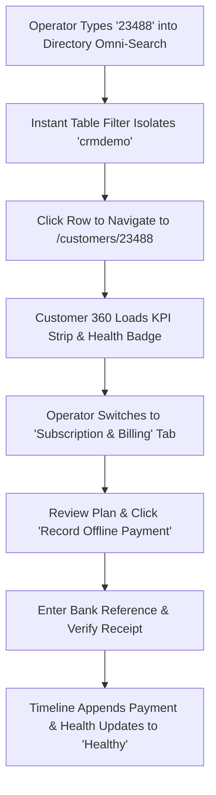

# Product Requirements Document (PRD)
## Sprint 3: Customer Management & Customer 360

---

### 1. Document Control & Metadata
- **Document Title:** Product Requirements Document - Sprint 3: Customer Management & Customer 360
- **Document Version:** 1.0.0
- **Status:** In Progress
- **Author:** CICOD Product & Architecture Team
- **Target Sprint:** Sprint 3 (Week 4)
- **Target Audience:** Customer Success Managers, Support Leads, Collections Officers, Frontend & Backend Engineers
- **Reference Code:** [customers/page.tsx](file:///c:/Users/CI-STAFF/Documents/CICOD%20TEST/Cicod%20CRM/src/app/crm/customer-mgt/customers/page.tsx), [CustomerView.tsx](file:///c:/Users/CI-STAFF/Documents/CICOD%20TEST/Cicod%20CRM/src/app/crm/customer-mgt/customers/%5Bid%5D/components/CustomerView.tsx)
- **Last Updated:** 2026-10-13

---

### 2. Executive Summary & Core Deliverables
In the legacy CRM, searching for a merchant required manually picking a "Filter Type" dropdown first, or the search did nothing. Customer health was invisible (an account 40+ days overdue still showed a green "Active" badge). Pagers were broken beyond record #1,340 of 13,355 records. Customer detail views locked to a single hard-coded record ("Obiora"), and high-risk actions like "Suspend Customer" were unconfirmed buttons placed directly next to "Update Customer". Furthermore, tenant onboarding stopped after collecting contact info, leaving new accounts unbilled and without plan bindings.

Sprint 3 delivers an enterprise-grade customer directory with instant omni-search, operational segment tabs, a dynamic **Customer 360 View** with derived health badges, safe suspension workflows, and a **4-Step Onboarding Wizard** that binds plans on creation.

#### Core Deliverables
1. **Debounced Omni-Search:** Universal search across Company Name, Domain, CICOD Number, Email, and Phone with zero filter prerequisites.
2. **Operational Segment Tabs:** Real-time triage views for *All*, *Trials Ending (≤7d)*, *Renewal Overdue*, *Onboarding Stuck (>14d)*, and *Suspended*.
3. **Dynamic Customer 360 View (`/crm/customer-mgt/customers/[id]`):** Fully parameterized route rendering live entity graphs by CICOD ID or UUID.
4. **5-KPI Executive Summary Strip:** Plan, Normalized Monthly Revenue (MRR), Seat Utilization (e.g. 4/5 seats), Renewal Date, and Last Payment Amount.
5. **Consolidated 5-Tab Layout:** Overview (with onboarding stepper), Subscription & Billing, Users & Seats, Support Tickets, and Unified Chronological Activity/Notes timeline.
6. **Safe Suspension Flow:** Relocated dangerous actions behind header menus with mandatory reason codes and automatic timeline logging.
7. **Complete 4-Step Onboarding Wizard:** Business profile, E.164 phone normalization, commercial plan binding, and instant redirect to Customer 360.

---

### 3. Product Vision & Strategic Objectives
- **Zero-Friction Discovery:** Any support agent or account executive must locate a tenant profile in `< 2 seconds` using any piece of customer identifier.
- **Proactive Churn Intervention:** Derived health badges (`Due Soon`, `Overdue`, `Trial Expiring`) surface at-risk accounts before service disruption occurs.
- **Complete Operational Context:** Unify contracts, licenses, tickets, and internal team comments into a single scrollable pane.

---

### 4. Target Audience & User Personas
- **Customer Success Manager:** Audits onboarding progression and reaches out to merchants entering the final 7 days of their free trial.
- **Support Operations Agent:** Quickly validates active subscription tiers, seat limits, and ticket history during merchant inquiry calls.
- **Collections & Risk Specialist:** Identifies delinquent accounts, reviews billing reminders, and safely suspends non-compliant tenants.

---

### 5. Scope Boundaries

#### 5.1 In-Scope
- Customer directory table with 2-line merchant cells and derived health badges.
- Debounced universal omni-search and URL query persistence (`?segment=overdue&q=crmdemo`).
- Customer 360 profile route with 5-metric KPI ribbon and alert banner.
- 5 profile sub-tabs: Overview, Subscription & Billing, Users, Tickets, Activity & Notes.
- Safe suspension modal with mandatory category dropdown and notes requirement.
- In-page operator note posting to Activity stream.
- 4-step new customer onboarding wizard with plan selection and E.164 phone formatting.

#### 5.2 Out-of-Scope
- Direct customer banking debit automation (handled in Sprint 4 Billing & Collections).
- End-user merchant self-management portal (this PRD governs internal staff CRM).
- Live telephony/call recording embedded in browser.

---

### 6. Comprehensive User Flow & Journey Maps

#### 6.1 Primary Happy Path Flow


#### 6.2 Alternate & Exception Flows
- **Overdue Account Triage:** User clicks "Renewal Overdue" segment tab. Directory lists all accounts with unpaid invoices. Selecting an account displays a top red banner: *"⚠ Renewal overdue by 41 days. ₦8,000 due. [Send Invoice] [Suspend]"*.
- **Suspension Safety Intercept:** Operator clicks "Suspend Customer" from header dropdown. Modal prompts for mandatory reason code ("Non-payment past grace period") and audit explanation. Submitting updates status to `Suspended`, revokes API keys, and logs event to Activity timeline.
- **Subdomain Collision in Onboarding:** In Step 1 of Onboarding, user types `demo`. Live validator checks registry and displays: *"Subdomain 'demo.cicod.com' is already registered. Please choose another."*

---

### 7. Functional Requirements (FRs)

#### 7.1 Customer Directory & Omni-Search
- **FR-3.1.1:** Single search input must execute across Company Name, Subdomain, CICOD Number, Contact Email, and Phone number without prior dropdown selection.
- **FR-3.1.2:** Search input must fire queries with a 250ms debounce and update URL query params (`?q=`).
- **FR-3.1.3:** Segment filter tabs must include live count badges: *All*, *Trials Ending (≤7d)*, *Renewal Overdue*, *Onboarding Stuck (>14d)*, *Suspended*.
- **FR-3.1.4:** Customer list table rows must display:
  - Cell 1: Company Name + CICOD ID (line 1), Contact Name + Email (line 2).
  - Cell 2: Sector and Business Type.
  - Cell 3: Plan tier name and monthly billable value.
  - Cell 4: Derived Health Badge (`Healthy`, `Due Soon`, `Overdue [n]d`, `Trial [n]d`, `Suspended`).
  - Cell 5: Quick actions menu (`View Profile`, `Copy Subdomain`, `Log Note`).

#### 7.2 Customer 360 Hub
- **FR-3.2.1:** Route `/crm/customer-mgt/customers/[id]` must dynamically fetch entity details using URL param.
- **FR-3.2.2:** Profile header must present: Company Name, CICOD ID, Lifecycle State, Health Badge, Subdomain hyperlink, and Industry Sector.
- **FR-3.2.3:** KPI Summary strip must render 5 standardized cards: Plan Tier, MRR, Users vs License limit, Next Renewal Date, Last Payment.
- **FR-3.2.4:** Overview Tab must display onboarding lifecycle progress tracker, primary business details, authorized contact persons, and uploaded compliance docs.
- **FR-3.2.5:** Subscription & Billing Tab must detail active commercial plan, add-on modules, invoice history with download links, and "Record Offline Payment" action.
- **FR-3.2.6:** Users Tab must list registered tenant staff, roles, and seat consumption progress bar.
- **FR-3.2.7:** Tickets Tab must display active customer support tickets with severity and status badges.
- **FR-3.2.8:** Activity & Notes Tab must provide an inline note composer (`textarea` + "Post Note" button) and an append-only timeline interleaving system events and staff comments.

#### 7.3 Safe Suspension Mechanism
- **FR-3.3.1:** Suspend action must be guarded inside header actions menu with red danger styling.
- **FR-3.3.2:** Suspension modal must require selection of `reasonCode` and minimum 10-character explanation in `notes`.
- **FR-3.3.3:** Execution must update tenant state to `Suspended` and write an audit event into the timeline.

#### 7.4 4-Step Onboarding Wizard
- **FR-3.4.1:** Step 1 (Business Info): Company Name, Subdomain (with debounced availability check), Sector, Business Type.
- **FR-3.4.2:** Step 2 (Primary Contact): Full Name, Work Email, Phone Number (auto-formatted to E.164: `+234...`).
- **FR-3.4.3:** Step 3 (Plan Selection): Product/Bundle picker, Billing Period (Monthly/Annual), Trial toggle.
- **FR-3.4.4:** Step 4 (Review & Provision): Summary confirmation; submits and redirects to new Customer 360 profile.

---

### 8. Non-Functional Requirements (NFRs)

#### 8.1 Performance & Latency
- Omni-search queries must return filtered results in `< 180ms` against a 15,000+ customer dataset.
- Customer 360 view data must load in a single consolidated API payload in `< 350ms`.

#### 8.2 Security & Compliance
- Role-based access control: Only users with `ROLE_RISK_OFFICER` or `ROLE_SUPERADMIN` can execute tenant suspension or reactivation.
- Customer contact numbers must be sanitized and encrypted at rest in accordance with NDPR and GDPR requirements.

#### 8.3 Reliability & Availability
- Derived health calculation logic must be deterministic and testable via pure TypeScript functions.
- If network disconnection occurs during onboarding submission, retry idempotency key prevents duplicate tenant creation.

#### 8.4 Usability & Accessibility
- Clean typography hierarchy with monospaced styling for CICOD numbers and monetary figures.
- Direct copy buttons with clipboard tooltips for Subdomains, Emails, and CICOD IDs.

---

### 9. Detailed User Stories & Acceptance Criteria

#### User Story 3.1: Frictionless Omni-Search
*As a Support Operations Agent, I want to type a customer's phone number or CICOD ID into a single search box without choosing a dropdown first, so that I can pull up their file in seconds while on a live phone call.*
- **AC-3.1.1:** Entering `23488` in the omni-search input filters the table to the exact matching customer within 250ms.
- **AC-3.1.2:** Entering `+234907` filters the directory by matching phone records across all sectors.

#### User Story 3.2: Visualizing At-Risk Accounts
*As a Customer Success Manager, I want overdue accounts to be clearly badged in amber/red with an action banner, so that I can prevent account churn before termination.*
- **AC-3.2.1:** Any account whose `nextRenewalDate` is in the past displays an `Overdue (n days)` badge.
- **AC-3.2.2:** The profile page renders an alert banner with direct CTAs to "Send Invoice" or "Record Offline Payment".

#### User Story 3.3: Plan-Bound Customer Creation
*As an Onboarding Specialist, I want to assign a commercial plan during customer creation, so that new tenants are immediately billable and provisioned with correct license limits.*
- **AC-3.3.1:** Step 3 of the onboarding wizard allows selecting an active catalogue plan and billing interval.
- **AC-3.3.2:** Submitting provisions the tenant and forwards to `/crm/customer-mgt/customers/[id]` with plan details visible.

---

### 10. Technical Architecture & Data Models

#### Customer Entity Schema
```typescript
export interface CustomerListItem {
  id: string;
  cicodNumber: string;
  companyName: string;
  subdomain: string;
  primaryContact: {
    name: string;
    email: string;
    phone: string;
  };
  sector: string;
  businessType: string;
  plan: {
    code: string;
    name: string;
    monthlyValue: number;
    currency: "NGN" | "USD" | "GBP";
  };
  status: "Active" | "Pending" | "Suspended" | "Archived";
  health: "Healthy" | "Due Soon" | "Overdue" | "Trial" | "Suspended";
  overdueDays?: number;
  trialRemainingDays?: number;
  nextRenewalDate: string;
  lastPaymentDate?: string;
  createdAt: string;
}

export interface Customer360DTO extends CustomerListItem {
  licenseAllocation: {
    usedSeats: number;
    totalSeats: number;
    storageUsedGb: number;
    storageLimitGb: number;
  };
  invoices: Array<{
    id: string;
    invoiceNumber: string;
    amount: number;
    currency: string;
    status: "Paid" | "Pending" | "Overdue";
    dueDate: string;
  }>;
  tickets: Array<{
    id: string;
    ticketNumber: string;
    subject: string;
    severity: "Low" | "Medium" | "High" | "Critical";
    status: "Open" | "In Progress" | "Resolved";
    updatedAt: string;
  }>;
  activities: Array<{
    id: string;
    type: "NOTE" | "PAYMENT" | "STATUS_CHANGE" | "INVOICE";
    author: string;
    title: string;
    description: string;
    createdAt: string;
  }>;
}
```

#### REST API Endpoints
| Method | Endpoint | Description | Status Codes |
|---|---|---|---|
| `GET` | `/api/v2/customers` | Directory omni-search with segment filters | `200` |
| `GET` | `/api/v2/customers/{id}` | Consolidated Customer 360 record | `200`, `404` |
| `POST` | `/api/v2/customers` | Create and provision customer with plan | `201`, `400` |
| `POST` | `/api/v2/customers/{id}/suspend` | Suspend tenant with mandatory audit reason | `200`, `422` |
| `POST` | `/api/v2/customers/{id}/reactivate` | Reactivate suspended tenant | `200` |
| `POST` | `/api/v2/customers/{id}/notes` | Post operator note to Activity timeline | `201` |

---

### 11. Edge Cases & Error Handling Strategies
- **Non-Existent Customer ID:** If `/customers/99999` is requested, UI renders a helpful 404 state with "Return to Directory" CTA.
- **Duplicate Subdomain:** Onboarding form validates subdomain uniqueness on blur; blocks submission if taken.
- **Unformatted International Phone:** Sanitizer strips local zero prefixes and attaches proper country code (e.g. `0907...` → `+234 907...`).
- **Concurrent Suspension & Payment:** If a payment confirms while an operator suspends, webhook resolves customer to `Active` and alerts operator.

---

### 12. Success Metrics & Key Performance Indicators (KPIs)
- **Search Success Rate:** 100% of staff searches locate records without needing assistance or direct database queries.
- **Mean Time to Customer Context (MTCC):** Reduced from 4.5 minutes across disconnected pages to `< 15 seconds` via Customer 360.
- **Onboarding Plan Attachment:** 100% of newly created tenants have an assigned commercial tier at creation.
- **Suspension Audit Compliance:** 100% of suspended accounts have logged operator reasons.

---

### 13. Release Plan, Milestones & Rollout Strategy
- **Milestone 3.1 (Days 1–3):** Omni-search customer table with URL sync and segment tabs.
- **Milestone 3.2 (Days 4–7):** Parameterized Customer 360 view with 5 KPI metrics and 5 consolidated tabs.
- **Milestone 3.3 (Days 8–9):** Safe suspension drawer and Activity/Notes timeline composer.
- **Milestone 3.4 (Day 10):** 4-step onboarding wizard with plan selection and integration tests.

---

### 14. Open Questions, Risks & Dependencies
- **Risk:** Existing database contains historical records with malformed phone numbers and null sectors.
  - *Mitigation:* Apply lenient schema parsers with fallback display values ("Unspecified") in Customer 360.
- **Dependency:** Catalogue plans from Sprint 2 must be queryable in Step 3 of the onboarding wizard.
- **Open Question:** Should support ticket creation be embedded directly in the Customer 360 Tickets tab?
  - *Resolution:* Sprint 3 supports viewing tickets and linking to external desk; direct ticket creation is scheduled for post-v2 release.
