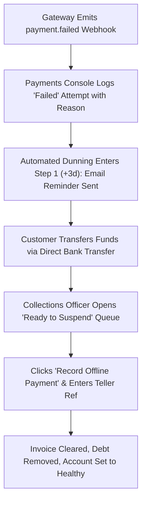

# Product Requirements Document (PRD)
## Sprint 4: Billing, Payments, Collections & Dunning

---

### 1. Document Control & Metadata
- **Document Title:** Product Requirements Document - Sprint 4: Billing, Payments, Collections & Dunning
- **Document Version:** 1.0.0
- **Status:** In Progress
- **Author:** CICOD Product & Architecture Team
- **Target Sprint:** Sprint 4 (Week 5)
- **Target Audience:** Finance Directors, Billing Specialists, Collections Officers, Frontend & Backend Engineers
- **Reference Code:** [billing/page.tsx](file:///c:/Users/CI-STAFF/Documents/CICOD%20TEST/Cicod%20CRM/src/app/crm/billing/page.tsx), [PolicyEditor.tsx](file:///c:/Users/CI-STAFF/Documents/CICOD%20TEST/Cicod%20CRM/src/app/crm/billing/components/PolicyEditor.tsx), [CollectionsView.tsx](file:///c:/Users/CI-STAFF/Documents/CICOD%20TEST/Cicod%20CRM/src/app/crm/billing/components/CollectionsView.tsx)
- **Last Updated:** 2026-10-13

---

### 2. Executive Summary & Core Deliverables
In the legacy platform, the subscription payments table marked every transaction as "CONFIRMED" despite 87% having failed at payment gateways. Financial aggregates were inaccurate, dunning policies covered only 2 of 7 billing models leaving overdue merchants unchased, and manual bank transfer reconciliation lacked structured audit controls and mandatory transaction reference validation.

Sprint 4 delivers an end-to-end financial operations cockpit: a **Billing Overview Dashboard** with reconciled MRR and recovery rates, a **Payments Console** reflecting authentic gateway statuses (`Paid`, `Failed`, `Pending`, `Refunded`) with retry logs, an actionable **Collections Workbench** with an offline reconciliation modal, and a visual **Dunning Policy Timeline Editor**.

#### Core Deliverables
1. **Executive Billing Dashboard:** High-level cards for MRR, Outstanding Collections, 7-day Payment Failures, and Dunning Recovery Rate.
2. **True-Status Payments Console:** Real-time transaction statuses, debit retry grouping by order, and slide-out Attempt Detail Drawers.
3. **Customer Payment Link Dispatcher:** One-click email/SMS payment portal link generation for failed transactions.
4. **Collections Workbench:** Dedicated triage queues (*All Overdue*, *In Grace Period*, *Ready to Suspend*, *Paused/Disputed*).
5. **Offline Payment Reconciliation Drawer:** Bank transfer record keeper with mandatory bank reference number, receipt attachment, and instant balance clearing.
6. **Visual Dunning Policy Builder:** Interactive pre-due (-14d to -1d) and post-due (+1d to +30d) timeline editor with email/SMS preview and auto-suspension triggers.
7. **Billing Model Coverage Tracker:** Real-time indicator displaying which commercial billing models lack active dunning rules.

---

### 3. Product Vision & Strategic Objectives
- **Financial Truth & Integrity:** Eliminate illusory "CONFIRMED" states; ensure every Naira, Dollar, and Pound reflects settled bank or gateway funds.
- **Automated Revenue Recovery:** Minimize involuntary churn by chasing expiring cards and failed payments with automated multi-channel cadences.
- **Auditable Reconciliation:** Ensure every offline transaction has verifiable banking documentation before ledger updates.

---

### 4. Target Audience & User Personas
- **Finance Director:** Monitors monthly recurring revenue trends, accounts receivable aging, and net recovery rates.
- **Billing Specialist:** Investigates gateway failure codes (insufficient funds, expired cards) and coordinates invoice re-issuance.
- **Credit Control & Collections Officer:** Manages merchants approaching the end of grace periods, reviewing disputes or recording bank transfers.

---

### 5. Scope Boundaries

#### 5.1 In-Scope
- Billing executive dashboard with dynamic drill-down links.
- Payments table with filters for date, gateway channel, and status (`Paid`, `Failed`, `Pending`, `Refunded`).
- Gateway attempt drawer displaying raw provider error messages.
- Collections queue management with "Pause Chasing" workflow.
- Offline payment modal enforcing bank teller reference.
- Visual Dunning Timeline Editor for all billing models.
- Policy coverage audit indicator.

#### 5.2 Out-of-Scope
- Direct integration with general ledger ERPs (SAP/NetSuite) — targeted for post-v2 release.
- Physical card terminal (POS) hardware firmware updates.
- Customer-facing payment gateway checkout modal (backend webhook ingestion focus).

---

### 6. Comprehensive User Flow & Journey Maps

#### 6.1 Primary Happy Path Flow


#### 6.2 Alternate & Exception Flows
- **Disputed Invoice Pause:** Merchant disputes bill. Collections officer clicks "Pause Chasing" and selects reason "Billing Dispute". Account is moved to the "Paused" tab, and automated dunning reminders are halted.
- **Grace Period Expiry (Auto-Suspend Mode):** If a dunning policy has "Auto-suspend" toggled ON and the account passes Day 14 without payment, system transitions tenant to `Suspended` and notifies customer success.
- **Duplicate Offline Reference Check:** If an officer enters a bank reference already present in the ledger, the system blocks submission with a duplicate alert: *"Reference REF-88492 was already recorded on 2026-09-12"*.

---

### 7. Functional Requirements (FRs)

#### 7.1 Billing Overview & Metrics
- **FR-4.1.1:** Dashboard must calculate Total MRR, Outstanding Collections, 7-day Payment Failures, and Dunning Recovery %.
- **FR-4.1.2:** Metric cards must act as interactive filters (e.g., clicking "Failed Payments" opens `/crm/billing/payments?status=Failed`).

#### 7.2 Payments Console & Gateway Retries
- **FR-4.2.1:** Transaction table must display authentic statuses: `Paid`, `Failed`, `Pending`, `Refunded`.
- **FR-4.2.2:** Multiple automated retry attempts on a single invoice must collapse into an expandable order row.
- **FR-4.2.3:** Clicking a row must slide open the Attempt Detail Drawer showing timestamp, card last 4 digits, gateway response (e.g. `Insufficient Funds`), and reference ID.
- **FR-4.2.4:** Drawer must offer "Send Payment Link" CTA triggering customer email/SMS with secure checkout URL.

#### 7.3 Collections Workbench
- **FR-4.3.1:** Workbench must segment accounts into 4 views: `All Overdue`, `In Grace Period`, `Ready to Suspend`, and `Paused`.
- **FR-4.3.2:** "Record Offline Payment" modal must require: Settled Amount, Payment Method, Payment Date, Bank Reference Number, and Internal Notes.
- **FR-4.3.3:** Submitting offline settlement must immediately update invoice to `Paid`, clear overdue balance, and set customer health badge to `Healthy`.
- **FR-4.3.4:** "Pause Chasing" action must require documented reason and target resume date.

#### 7.4 Dunning Policy Studio
- **FR-4.4.1:** Must display visual coverage meter: *"Coverage: X of Y billing models covered by active policy"*.
- **FR-4.4.2:** Visual timeline must support drag-and-drop or stepper addition of pre-due (-14d to -1d) and post-due (+1d to +30d) reminder steps.
- **FR-4.4.3:** Each step must support Step Type (`Reminder`, `Warning`, `Final Notice`), Email Template, and SMS Template selection.
- **FR-4.4.4:** Right-hand pane must display live rendered template preview using placeholder tenant data.
- **FR-4.4.5:** Policy options must include Grace Period days, "Suspend automatically" switch, and "Skip customers with pending bank transfer" switch.

---

### 8. Non-Functional Requirements (NFRs)

#### 8.1 Performance & Latency
- Webhook processor must handle incoming payment gateway payloads in `< 400ms`.
- Billing overview summary cards must load cached rollups in `< 300ms`.

#### 8.2 Security & Compliance
- PCI-DSS Compliance: Full credit card numbers and CVV codes must NEVER be stored, logged, or surfaced in the UI. Only card brand, expiry, and last 4 digits are permitted.
- Ledger Immutability: Offline payment records cannot be hard deleted; reversals require formal credit memo entries.

#### 8.3 Reliability & Availability
- Idempotent payment webhook ingestion: Duplicate webhook events from Paystack/Flutterwave/Stripe must not double-credit accounts.
- Dunning cron execution must maintain persistent offset locks to prevent duplicate customer message delivery.

#### 8.4 Usability & Accessibility
- Status indicators must use dual encoding (color + text label + icon) for color-blind accessibility.
- Monetary figures must format with currency symbols and two decimal places (e.g., `₦124,500.00`).

---

### 9. Detailed User Stories & Acceptance Criteria

#### User Story 4.1: Gateway Failure Inspection
*As a Billing Specialist, I want to see exactly why a merchant's auto-debit failed, so that I can send them a direct link or advise them to update their card details.*
- **AC-4.1.1:** Failed transactions display in red with reason chip (e.g., "Card Expired").
- **AC-4.1.2:** Opening the Attempt Detail Drawer reveals gateway error codes and allows dispatching a payment link.

#### User Story 4.2: Bank Transfer Reconciliation
*As a Collections Officer, I want to record an offline bank transfer with mandatory teller reference, so that the customer's account is restored to good standing immediately.*
- **AC-4.2.1:** Submitting the offline payment form without a Bank Reference displays an inline validation error.
- **AC-4.2.2:** On successful submission, the customer's balance updates to 0 and their status clears from "Ready to Suspend".

#### User Story 4.3: Visual Dunning Cadence
*As a Finance Director, I want to configure a 4-step dunning schedule with email and SMS previews, so that customers receive professional reminders without manual outreach.*
- **AC-4.3.1:** User can add a Step at -3 days (Gentle Reminder) and +7 days (Overdue Warning).
- **AC-4.3.2:** System validates that every step has at least one communication channel selected.

---

### 10. Technical Architecture & Data Models

#### Payment & Dunning Schemas
```typescript
export interface PaymentOrderDTO {
  id: string;
  orderNumber: string;
  customerId: string;
  companyName: string;
  amount: number;
  currency: "NGN" | "USD" | "GBP";
  status: "Paid" | "Failed" | "Pending" | "Refunded";
  billingModel: string;
  createdAt: string;
  latestAttempt?: {
    attemptId: string;
    gateway: "PAYSTACK" | "FLUTTERWAVE" | "STRIPE" | "OFFLINE";
    gatewayMessage: string;
    cardLast4?: string;
    cardBrand?: string;
    executedAt: string;
  };
}

export interface OfflinePaymentDTO {
  customerId: string;
  invoiceId: string;
  amount: number;
  currency: string;
  paymentMethod: "BANK_TRANSFER" | "CASH" | "POS" | "CHEQUE";
  paymentDate: string;
  bankReferenceNumber: string;
  receiptAttachmentUrl?: string;
  notes: string;
}

export interface DunningStep {
  id: string;
  offsetDays: number; // e.g. -7, -3, 1, 7, 14
  type: "REMINDER" | "WARNING" | "FINAL_NOTICE";
  emailTemplateId?: string;
  smsTemplateId?: string;
}

export interface DunningPolicy {
  id: string;
  name: string;
  billingModel: string;
  gracePeriodDays: number;
  autoSuspend: boolean;
  skipPausedCustomers: boolean;
  skipPendingTransfers: boolean;
  steps: DunningStep[];
  isActive: boolean;
}
```

#### REST API Endpoints
| Method | Endpoint | Description | Status Codes |
|---|---|---|---|
| `GET` | `/api/v2/billing/overview` | Executive financial pulse and recovery metrics | `200` |
| `GET` | `/api/v2/billing/payments` | True payment transactions with attempts | `200` |
| `GET` | `/api/v2/billing/payments/{id}/attempts` | Slide-out attempt details list | `200`, `404` |
| `POST` | `/api/v2/billing/payments/record-offline` | Record offline bank payment | `201`, `422` |
| `POST` | `/api/v2/billing/payments/send-link` | Dispatch checkout link via Email/SMS | `200` |
| `GET` | `/api/v2/billing/collections` | Triage queue of delinquent accounts | `200` |
| `GET` | `/api/v2/billing/dunning/policies` | Dunning policies with coverage status | `200` |
| `POST` | `/api/v2/billing/dunning/policies` | Save dunning policy cadence | `200`, `400` |

---

### 11. Edge Cases & Error Handling Strategies
- **Partial Payments:** If a customer transfers `₦50,000` on a `₦100,000` invoice, the system logs a partial payment and keeps remaining balance in Collections.
- **Simultaneous Webhook & Bank Transfer:** If an automated debit settles while an offline transfer is pending verification, the system flags the invoice for manual review to prevent double collection.
- **Missing SMS Provider Balance:** If SMS credits expire during dunning dispatch, the system falls back to email and logs a critical alert to the admin dashboard.

---

### 12. Success Metrics & Key Performance Indicators (KPIs)
- **Status Accuracy:** 100% elimination of false "CONFIRMED" displays.
- **Dunning Coverage:** 100% of commercial billing models covered by active dunning policies.
- **Overdue Invoices Settled:** > 35% automated recovery rate for overdue subscription accounts.
- **Offline Settlement Speed:** Offline bank transfers cleared in `< 2 minutes` by Collections staff.

---

### 13. Release Plan, Milestones & Rollout Strategy
- **Milestone 4.1 (Days 1–2):** Billing KPI Overview & drill-down metrics.
- **Milestone 4.2 (Days 3–5):** True-status Payments console and attempt detail slide-out drawer.
- **Milestone 4.3 (Days 6–7):** Collections Workbench and offline payment reconciliation modal.
- **Milestone 4.4 (Days 8–10):** Dunning visual timeline builder and end-to-end webhook integration tests.

---

### 14. Open Questions, Risks & Dependencies
- **Risk:** Gateway webhooks may arrive out of order during network congestion.
  - *Mitigation:* Webhook handler orders events by gateway transaction timestamp, not HTTP arrival time.
- **Dependency:** Template library from Sprint 6 must provide email/SMS templates for dunning step configuration.
- **Open Question:** Should partial offline payments reset customer health immediately?
  - *Resolution:* Partial payments update balance but keep health badge as `Due Soon` until fully cleared.
