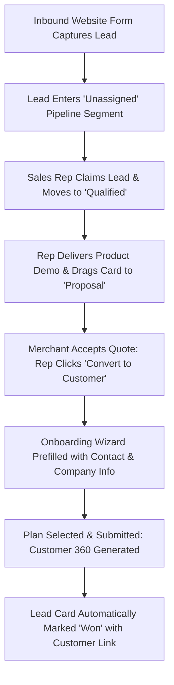

# Product Requirements Document (PRD)
## Sprint 5: Growth Pipeline: Leads & Partners

---

### 1. Document Control & Metadata
- **Document Title:** Product Requirements Document - Sprint 5: Growth Pipeline: Leads & Partners
- **Document Version:** 1.0.0
- **Status:** In Progress
- **Author:** CICOD Product & Architecture Team
- **Target Sprint:** Sprint 5 (Week 6)
- **Target Audience:** Sales Leads, Account Executives, Partner Channel Managers, Frontend & Backend Engineers
- **Reference Code:** [leads/page.tsx](file:///c:/Users/CI-STAFF/Documents/CICOD%20TEST/Cicod%20CRM/src/app/crm/growth/leads/page.tsx), [partners/page.tsx](file:///c:/Users/CI-STAFF/Documents/CICOD%20TEST/Cicod%20CRM/src/app/crm/growth/partners/page.tsx), [commission/page.tsx](file:///c:/Users/CI-STAFF/Documents/CICOD%20TEST/Cicod%20CRM/src/app/crm/growth/commission/page.tsx)
- **Last Updated:** 2026-10-13

---

### 2. Executive Summary & Core Deliverables
The legacy `/crm/lead` endpoint threw API error 400 and failed to render, while prospects were siloed in an obsolete `/crm/account/view-prospect` page that crashed with HTTP 500, fragmenting the acquisition funnel. There was no connection between qualified leads and customer onboarding, forcing reps to manually re-type customer details into separate forms. In addition, 400 commercial partners lacked a KYC verification queue, and commission formulas were stored as ambiguous dimensionless numbers like "PERCENT 0.3".

Sprint 5 establishes a high-velocity acquisition suite: an interactive **Leads Pipeline** (with both Table and visual Kanban board views), a frictionless **Convert to Customer** workflow, a dedicated **Partner KYC Verification Queue**, and a **Commission Configuration Engine** featuring real-time worked mathematical examples.

#### Core Deliverables
1. **Interactive Dual-View Leads Pipeline:** Toggle effortlessly between high-density data tables and interactive drag-and-drop Kanban boards across 5 stages (`New` → `Qualified` → `Demo` → `Proposal` → `Won`/`Lost`).
2. **Actionable Lead Segments:** Segment tabs for *All Open*, *Unassigned Inbound*, *My Leads*, *Follow-up Due*, *Won*, and *Lost*.
3. **Streamlined Quick-Create Drawer:** High-conversion 6-field capture drawer replacing the legacy 17-field roadblock.
4. **One-Click "Convert to Customer":** Deep integration that pre-fills the 4-step onboarding wizard and establishes persistent bidirectional links between deal and tenant.
5. **Partner Verification & KYC Desk:** Verification workflow for Independent Commercial Entities (ICEs), Business Partners, and Delivery Partners.
6. **Transparent Commission Engine:** Clear configuration cards with explicit percentage/fixed units and real-world worked calculation examples.

---

### 3. Product Vision & Strategic Objectives
- **Zero Lead Leakage:** Ensure every inbound web signup is captured, routed, and triaged within 15 minutes of submission.
- **Frictionless Deal Progression:** Give sales teams visual Kanban clarity to manage pipeline velocity and prevent stalled proposals.
- **Trustworthy Partner Ecosystem:** Provide certified channel partners with transparent referral tracking and undisputed commission statements.

---

### 4. Target Audience & User Personas
- **Inbound Sales Representative:** Triages incoming signups, executes discovery calls, and schedules product demonstrations.
- **Sales Director:** Analyzes deal velocity, stage conversion bottlenecks, and rep quota distribution.
- **Partner Channel Manager:** Evaluates reseller applications, reviews compliance documents, and approves commission disbursements.

---

### 5. Scope Boundaries

#### 5.1 In-Scope
- Dual Table / Kanban board interface for lead pipeline (`/crm/growth/leads`).
- Drag-and-drop stage updates with mandatory loss-reason prompt on drop to `Lost`.
- Quick-create lead drawer with automatic sales rep round-robin assignment.
- Deep integration between Lead conversion and Customer Onboarding wizard.
- Partner directory and KYC verification queue (`/crm/growth/partners`).
- Multi-tier commission plan management with worked calculation examples (`/crm/growth/commission`).

#### 5.2 Out-of-Scope
- Complex CPQ (Configure, Price, Quote) legal document generation.
- Automated bank payout disbursements to partners (handled in Sprint 4 Billing or ERP).
- Public affiliate affiliate portal frontend (internal CRM staff management focus).

---

### 6. Comprehensive User Flow & Journey Maps

#### 6.1 Primary Happy Path Flow


#### 6.2 Alternate & Exception Flows
- **Deal Lost to Competitor:** Rep drags lead card to `Lost` column. System intercepts drop and opens modal: *"Select Loss Reason: [Competitor / Price / Timing / Unresponsive]"*. Rep enters explanation; deal is archived to Lost segment.
- **Partner KYC Rejection:** Channel manager inspects affiliate registration. Uploaded CAC document has expired. Manager clicks "Reject", enters reason, and an automated notification is dispatched to the affiliate.
- **Duplicate Lead Collision:** When creating a new lead with an existing email, system displays a prompt: *"A lead with email 'ceo@acme.ng' already exists (Assigned to Sarah K.). View existing lead?"*.

---

### 7. Functional Requirements (FRs)

#### 7.1 Leads Pipeline & Kanban Workspace
- **FR-5.1.1:** Must provide a view switch between dense Data Table and 5-stage Kanban Board (`New`, `Qualified`, `Demo`, `Proposal`, `Won`/`Lost`).
- **FR-5.1.2:** Dragging cards between Kanban columns must optimistically update stage and persist via `PATCH /api/v2/growth/leads/{id}/stage`.
- **FR-5.1.3:** Filter segments must display real-time counters: *All Open*, *Unassigned*, *My Leads*, *Follow-up Due*, *Won*, and *Lost*.
- **FR-5.1.4:** Quick-create drawer must collect: Business Name, Contact Name, Email, Phone, Lead Source, Desired Product, Estimated Value, and Next Action Date.

#### 7.2 Lead Conversion Engine
- **FR-5.2.1:** Qualified and Proposal leads must present a prominent "Convert to Customer" CTA.
- **FR-5.2.2:** Clicking Convert must route to Customer Onboarding with Company Name, Subdomain suggestion, Primary Contact, Email, and Phone pre-populated.
- **FR-5.2.3:** Submitting the onboarding form must mark the lead as `Won` and write an activity item to both lead and customer audit logs.

#### 7.3 Partner Management & Verification Queue
- **FR-5.3.1:** Directory must categorize partners: `Independent Commercial Entities (ICEs)`, `Business Partners`, and `Delivery Partners`.
- **FR-5.3.2:** "Pending Verification" tab must display partner applications requiring compliance sign-off.
- **FR-5.3.3:** Review drawer must display registration documents, tax IDs, and bank account verification.
- **FR-5.3.4:** Approving a partner must generate an immutable, unique affiliate referral code (e.g. `REF-ICE-9921`).

#### 7.4 Commission Configuration Studio
- **FR-5.4.1:** Configuration cards must support `PERCENTAGE (%)` or `FIXED (₦/$)` compensation models.
- **FR-5.4.2:** Every commission card must dynamically evaluate and display a plain-language worked example (e.g. *"When a referred customer pays ₦15,000/month, the partner earns ₦750 (5%) per cycle"*).

---

### 8. Non-Functional Requirements (NFRs)

#### 8.1 Performance & Latency
- Kanban board drag-and-drop animations must maintain 60 FPS performance on standard desktop browsers.
- Lead table omni-filter must filter 2,000+ opportunities in `< 50ms`.

#### 8.2 Security & Compliance
- Data isolation: Sales reps without manager permissions can only view leads assigned to their territory or personal account.
- Affiliate banking and tax details must be encrypted at rest.

#### 8.3 Reliability & Availability
- Optimistic Kanban updates must gracefully rollback with a user alert if the background API patch fails.
- Prevention of duplicate partner referral codes using unique database constraints.

#### 8.4 Usability & Accessibility
- Kanban columns must display cumulative deal pipeline values in column headers (e.g., `Proposal · 12 deals · ₦14.2M`).
- High-contrast visual priority indicators for deals with follow-ups overdue.

---

### 9. Detailed User Stories & Acceptance Criteria

#### User Story 5.1: Pipeline Kanban Velocity
*As a Sales Representative, I want to drag deals across stages and immediately see total stage values, so that I can prioritize my closing efforts for the week.*
- **AC-5.1.1:** Dragging a card from "Qualified" to "Demo" updates the card's column and recalculates column aggregate values immediately.
- **AC-5.1.2:** Dropping a card onto "Lost" requires selecting a loss reason before completing the move.

#### User Story 5.2: Streamlined Lead Conversion
*As an Account Executive, I want to convert a closed deal into an active customer without re-entering their profile data, so that onboarding is instant and error-free.*
- **AC-5.2.1:** Clicking "Convert to Customer" pre-populates all company and contact fields in the onboarding wizard.
- **AC-5.2.2:** Completing onboarding links the new customer tenant to the original lead record.

#### User Story 5.3: Transparent Commission Setup
*As a Partner Channel Manager, I want commission rules to display worked calculation examples, so that affiliate agreements have zero arithmetic ambiguity.*
- **AC-5.3.1:** Entering a 5% commission rate immediately renders an example showing payout on standard subscription tiers.

---

### 10. Technical Architecture & Data Models

#### Schemas
```typescript
export type LeadStage = "NEW" | "QUALIFIED" | "DEMO" | "PROPOSAL" | "WON" | "LOST";

export interface LeadDTO {
  id: string;
  businessName: string;
  contactName: string;
  email: string;
  phone: string;
  source: "WEBSITE" | "AFFILIATE" | "DIRECT" | "OUTBOUND";
  desiredProductId: string;
  estimatedMonthlyValue: number;
  stage: LeadStage;
  ownerId: string;
  ownerName: string;
  nextFollowUpDate?: string;
  lostReason?: string;
  convertedCustomerId?: string;
  createdAt: string;
  updatedAt: string;
}

export interface PartnerDTO {
  id: string;
  companyName: string;
  contactName: string;
  email: string;
  phone: string;
  partnerType: "ICE" | "BUSINESS_PARTNER" | "DELIVERY_PARTNER";
  verificationStatus: "PENDING" | "VERIFIED" | "REJECTED";
  referralCode: string;
  referredMerchantsCount: number;
  totalGmvGenerated: number;
  accruedCommission: number;
  createdAt: string;
}

export interface CommissionPlanDTO {
  id: string;
  partnerType: "ICE" | "BUSINESS_PARTNER" | "DELIVERY_PARTNER";
  model: "PERCENTAGE" | "FIXED";
  rate: number;
  currency: "NGN" | "USD" | "GBP";
  workedExampleText: string;
}
```

#### REST API Endpoints
| Method | Endpoint | Description | Status Codes |
|---|---|---|---|
| `GET` | `/api/v2/growth/leads` | Leads directory with segment filters | `200` |
| `POST` | `/api/v2/growth/leads` | Create prospective lead | `201`, `400` |
| `PATCH` | `/api/v2/growth/leads/{id}/stage` | Drag-and-drop stage transition | `200`, `422` |
| `POST` | `/api/v2/growth/leads/{id}/convert` | Convert lead to customer | `200`, `409` |
| `GET` | `/api/v2/growth/partners` | Commercial partners list with KYC status | `200` |
| `POST` | `/api/v2/growth/partners/{id}/verify` | Approve or reject partner application | `200` |
| `GET` | `/api/v2/growth/commission-plans` | Retrieve formula rules and examples | `200` |

---

### 11. Edge Cases & Error Handling Strategies
- **Network Failure During Kanban Drag:** Card snaps back to original column; a toast notification informs the user of the sync error.
- **Converting Already-Converted Lead:** If two reps attempt to convert simultaneously, backend concurrency check rejects the second with a link to the existing customer profile.
- **Missing Required KYC Documents:** "Verify Partner" button is disabled until all mandatory documentation has been reviewed.

---

### 12. Success Metrics & Key Performance Indicators (KPIs)
- **Lead Qualification Velocity:** Time from inbound web creation to first rep contact `< 30 minutes`.
- **Conversion Efficiency:** 100% of Won deals converted to customers via the automated wizard without manual data re-entry.
- **Partner Verification Backlog:** 0 unreviewed partner applications older than 48 hours.
- **Commission Accuracy:** 0 partner disputes regarding commission arithmetic or referral attribution.

---

### 13. Release Plan, Milestones & Rollout Strategy
- **Milestone 5.1 (Days 1–3):** Dual Table / Kanban board UI with drag-and-drop and stage column totals.
- **Milestone 5.2 (Days 4–5):** Quick-create lead drawer and segment filters with live counts.
- **Milestone 5.3 (Days 6–7):** Lead-to-Customer conversion workflow and activity log linking.
- **Milestone 5.4 (Days 8–10):** Partner KYC verification queue, commission configuration cards, and worked math validation.

---

### 14. Open Questions, Risks & Dependencies
- **Risk:** Existing sales reps accustomed to external spreadsheets may bypass entering leads into the CRM.
  - *Mitigation:* Connect inbound website signup webhooks directly to the CRM Lead creation endpoint.
- **Dependency:** Customer Onboarding Wizard from Sprint 3 must be available to accept prefilled query params.
- **Open Question:** Should commission tiers support multi-year recurring payouts or first-year only?
  - *Resolution:* Sprint 5 supports ongoing recurring commissions; contract expiration dates can be set on individual partner agreements.
