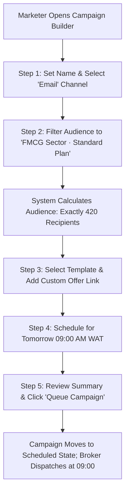

# Product Requirements Document (PRD)
## Sprint 6: Messaging, Campaigns & Trigger Engine

---

### 1. Document Control & Metadata
- **Document Title:** Product Requirements Document - Sprint 6: Messaging, Campaigns & Trigger Engine
- **Document Version:** 1.0.0
- **Status:** In Progress
- **Author:** CICOD Product & Architecture Team
- **Target Sprint:** Sprint 6 (Week 7)
- **Target Audience:** Growth Directors, Lifecycle Marketers, Support Operations Leads, Software Engineers
- **Reference Code:** [messaging/page.tsx](file:///c:/Users/CI-STAFF/Documents/CICOD%20TEST/Cicod%20CRM/src/app/crm/growth/messaging/page.tsx), [campaigns/page.tsx](file:///c:/Users/CI-STAFF/Documents/CICOD%20TEST/Cicod%20CRM/src/app/crm/growth/campaigns/page.tsx), [NotificationsView.tsx](file:///c:/Users/CI-STAFF/Documents/CICOD%20TEST/Cicod%20CRM/src/app/crm/settings/components/NotificationsView.tsx)
- **Last Updated:** 2026-10-13

---

### 2. Executive Summary & Core Deliverables
In the legacy platform, campaigns consisted merely of a name and dates with no audience definitions, message bodies, or delivery metrics. The communication template used for overdue invoice dunning erroneously read "Thank you for your order", while email template editors threw HTTP 400 errors. Automated triggers failed to fire, and website newsletter subscribers remained stranded in unworked static tables.

Sprint 6 implements an omnichannel communication engine: a **Shared Communication Template Library** (Email and SMS with dynamic placeholder chips and character counting), an interactive **5-Step Campaign Builder** with live recipient validation, an **Automated Event Trigger Engine** for critical tenant lifecycle milestones, and an actionable **Subscriber Conversion Hub**.

#### Core Deliverables
1. **Shared Multi-Channel Template Library:** Central repository of categorized templates (`Billing`, `Marketing`, `Onboarding`, `Transactional`) with click-to-insert variable tokens.
2. **Dynamic SMS Credit & Character Counter:** Real-time character counter showing segment breakdowns (e.g., 142/160 chars = 1 SMS; 184/160 chars = 2 SMS).
3. **Template Mismatch Safety Guard:** Warning modals preventing commercial marketing templates from being mistakenly wired into formal legal dunning notices.
4. **5-Step Campaign Builder:** Full stepper workflow covering Objective, Audience Segment Filtering, Message & Preview, Scheduling, and Readiness Verification.
5. **Campaign Analytics Funnel:** Real-time delivery funnel visualization (*Sent → Delivered → Opened → Clicked → Converted*).
6. **Automated Event Trigger Engine:** Event-driven notification rules responding to `customer.created`, `trial.ending`, `payment.failed`, and `subscription.suspended`.
7. **Subscriber Management Desk:** Central hub converting website newsletter subscribers into active sales pipeline leads.

---

### 3. Product Vision & Strategic Objectives
- **Cohesive Brand Voice:** Eliminate embarrassing template mismatches across billing, onboarding, and promotional touchpoints.
- **Precision Audience Targeting:** Enable marketers to segment audiences by plan tier, sector, and lifecycle health with exact pre-send recipient counts.
- **Hands-Free Lifecycle Engagement:** Automate onboarding welcomes, trial expiration warnings, and failed payment notices without engineering involvement.

---

### 4. Target Audience & User Personas
- **Growth Marketing Manager:** Builds multi-channel broadcast campaigns, creates segmented audiences, and optimizes conversion funnels.
- **Lifecycle Operations Specialist:** Drafts onboarding nurture sequences and ensures transactional notification rules are active.
- **Billing Specialist:** Selects approved, professional SMS and Email templates for automated dunning cadences.

---

### 5. Scope Boundaries

#### 5.1 In-Scope
- Shared Template Library for Email & SMS (`/crm/growth/messaging`).
- Variable chips (`{{customer_name}}`, `{{payment_link}}`, `{{due_date}}`, etc.).
- 5-step campaign builder (`/crm/growth/campaigns/new`) with live audience count.
- Campaign delivery funnel analytics view (`/crm/growth/campaigns/[id]`).
- System notification event trigger bindings (`/crm/settings/notifications`).
- Newsletter subscriber directory with one-click "Create Lead" action.

#### 5.2 Out-of-Scope
- Full visual drag-and-drop HTML email WYSIWYG builder (rich text and clean markdown template format utilized for deliverability).
- Custom WhatsApp Business API webhook onboarding (targeted for post-v2 release).
- Telemarketing outbound dialer integration.

---

### 6. Comprehensive User Flow & Journey Maps

#### 6.1 Primary Happy Path Flow


#### 6.2 Alternate & Exception Flows
- **Zero Recipient Block:** Marketer configures a filter combination resulting in 0 matching contacts. In Step 5, the "Launch Campaign" button is disabled with an amber warning: *"Cannot launch campaign: target audience contains 0 recipients"*.
- **High-Risk Template Re-assignment:** User attempts to attach a template with subject "Flash Sale 50% Off" to the `payment.failed` event trigger. System prompts: *"Warning: Selected template is categorized as Marketing. Are you sure you want to use this for transactional payment failure?"*.
- **Subscriber Unsubscribe Processing:** Recipient clicks one-click unsubscribe in email footer. System updates subscriber status to `Unsubscribed` and automatically removes them from active marketing segments.

---

### 7. Functional Requirements (FRs)

#### 7.1 Shared Template Library
- **FR-6.1.1:** Must support multi-channel repository for both Email and SMS, organized by categories: `Billing`, `Marketing`, `Onboarding`, and `Transactional`.
- **FR-6.1.2:** Must provide click-to-insert variable tokens: `{{customer_name}}`, `{{company}}`, `{{subdomain}}`, `{{due_date}}`, `{{amount}}`, `{{payment_link}}`.
- **FR-6.1.3:** SMS editor must render a real-time character counter and segment calculator (160 characters per standard GSM segment).
- **FR-6.1.4:** Must prevent deletion of templates currently linked to active dunning policies or active event triggers.

#### 7.2 5-Step Campaign Builder
- **FR-6.2.1:** Step 1 (Basics): Campaign Name, Objective, and Communication Channel (`Email` or `SMS`).
- **FR-6.2.2:** Step 2 (Audience): Dynamic filtering by Customer Status, Plan Tier, Industry Sector, or Partner Type, rendering real-time recipient counts.
- **FR-6.2.3:** Step 3 (Message): Template picker, subject line, body editor, and responsive mobile/desktop live preview.
- **FR-6.2.4:** Step 4 (Schedule): Immediate dispatch or date/time picker with timezone specification.
- **FR-6.2.5:** Step 5 (Review): Verification checklist and final confirmation modal displaying total recipients and estimated credits.

#### 7.3 Campaign Analytics & Reporting
- **FR-6.3.1:** Dedicated campaign overview page displaying KPI cards: Total Sent, Delivery Rate %, Open Rate %, Click Rate %, and Unsubscribe Rate.
- **FR-6.3.2:** Visual step funnel detailing conversion drops across each delivery milestone.

#### 7.4 Event Notification Triggers
- **FR-6.4.1:** Admin interface for binding triggers: `customer.created`, `trial.ending`, `payment.failed`, and `subscription.suspended`.
- **FR-6.4.2:** Each trigger must support toggle on/off, channel selection, template assignment, and internal staff CC alerts.

#### 7.5 Newsletter Subscribers Desk
- **FR-6.5.1:** Centralized subscriber directory displaying email, signup date, and subscription status.
- **FR-6.5.2:** "Convert to Lead" button creates a pre-populated opportunity in the Growth Pipeline (Sprint 5).

---

### 8. Non-Functional Requirements (NFRs)

#### 8.1 Performance & Latency
- Asynchronous dispatch: Campaign launches must queue to a background job broker (BullMQ/RabbitMQ) within `< 200ms`, never blocking user interface threads.
- Template rendering engine must parse and substitute variable tokens in `< 2ms` per message.

#### 8.2 Security & Compliance
- CAN-SPAM and GDPR Compliance: All outbound emails must include valid organization physical address, sender identity, and one-click unsubscribe links.
- XSS Prevention: Dynamic variables must be strictly HTML-sanitized before injection into email templates.

#### 8.3 Reliability & Availability
- Provider failover: If primary SMS gateway returns 5xx error, dispatch worker must automatically retry via secondary SMS provider.
- Rate limiting: Marketing broadcasts must be throttled to 50 emails/second to protect sender domain reputation.

#### 8.4 Usability & Accessibility
- Live message preview pane must simulate both desktop client and mobile screen sizes.
- Visual token chips must have keyboard focus indicators and tooltips showing sample value.

---

### 9. Detailed User Stories & Acceptance Criteria

#### User Story 6.1: Variable Token Injection
*As a Lifecycle Marketer, I want to click variable chips to insert customer names and payment links, so that messages are personalized without template syntax errors.*
- **AC-6.1.1:** Clicking `{{customer_name}}` inserts the exact token at the current cursor position in the message body.
- **AC-6.1.2:** Preview pane displays the resolved token with realistic mock data (e.g., "Hello Acme Ltd").

#### User Story 6.2: Pre-Send Recipient Validation
*As a Growth Marketing Manager, I want to see the exact recipient count before launching an SMS blast, so that we avoid accidental overages or sending to unintended segments.*
- **AC-6.2.1:** Selecting audience filters displays live recipient count in Step 2.
- **AC-6.2.2:** Launch modal displays: *"You are about to send 1,200 SMS messages (2 credits each = 2,400 total credits). Confirm?"*.

#### User Story 6.3: Automated Failed Payment Alerts
*As an Operations Specialist, I want the system to automatically trigger an SMS when a payment fails, so that merchants can update their card before service suspension.*
- **AC-6.3.1:** When `payment.failed` fires, the assigned template dispatches with the customer's unique payment link.

---

### 10. Technical Architecture & Data Models

#### Communication Schemas
```typescript
export interface TemplateDTO {
  id: string;
  name: string;
  category: "BILLING" | "MARKETING" | "ONBOARDING" | "TRANSACTIONAL";
  channel: "EMAIL" | "SMS";
  subject?: string;
  body: string;
  availableTokens: string[];
  isLocked: boolean;
  updatedAt: string;
}

export interface CampaignDTO {
  id: string;
  name: string;
  channel: "EMAIL" | "SMS";
  status: "DRAFT" | "SCHEDULED" | "SENDING" | "COMPLETED" | "CANCELLED";
  audienceFilter: {
    sectors?: string[];
    plans?: string[];
    statuses?: string[];
  };
  totalRecipients: number;
  templateId: string;
  scheduledAt?: string;
  analytics?: {
    sent: number;
    delivered: number;
    opened: number;
    clicked: number;
    unsubscribed: number;
  };
  createdAt: string;
}

export interface TriggerRuleDTO {
  event: "customer.created" | "trial.ending" | "payment.failed" | "subscription.suspended";
  enabled: boolean;
  channel: "EMAIL" | "SMS";
  templateId: string;
  staffCcEmails: string[];
}
```

#### REST API Endpoints
| Method | Endpoint | Description | Status Codes |
|---|---|---|---|
| `GET` | `/api/v2/messaging/templates` | Retrieve shared communication templates | `200` |
| `POST` | `/api/v2/messaging/templates` | Create or update template | `201`, `400` |
| `GET` | `/api/v2/campaigns` | List campaigns with statuses and metrics | `200` |
| `POST` | `/api/v2/campaigns` | Create campaign draft | `201`, `400` |
| `POST` | `/api/v2/campaigns/{id}/launch` | Queue campaign to background broker | `202`, `422` |
| `GET` | `/api/v2/settings/triggers` | Fetch lifecycle event notification bindings | `200` |
| `PATCH` | `/api/v2/settings/triggers/{event}` | Update trigger status and assigned template | `200` |

---

### 11. Edge Cases & Error Handling Strategies
- **Missing Customer Variable Data:** If a template includes `{{contact_name}}` but the record has no contact name, the engine gracefully falls back to "Valued Customer".
- **SMS Exceeding Maximum Concatenation:** If an SMS body exceeds 612 characters (4 concatenated segments), the editor blocks input and advises switching to email.
- **Recipient Domain Blacklisting:** If a recipient email domain is invalid or on a suppression list, the worker skips the send and flags the contact.

---

### 12. Success Metrics & Key Performance Indicators (KPIs)
- **Zero Template Mismatches:** 100% elimination of promotional copy in billing reminder notifications.
- **Campaign Execution Speed:** Campaigns queued and dispatched within `< 60 seconds` of scheduled time.
- **SMS Cost Efficiency:** 0 wasted credits caused by unmonitored character overflows.
- **Subscriber Conversion:** > 15% of captured website newsletter subscribers converted into qualified sales leads.

---

### 13. Release Plan, Milestones & Rollout Strategy
- **Milestone 6.1 (Days 1–3):** Shared template library with variable token chips and SMS character counting.
- **Milestone 6.2 (Days 4–6):** 5-step campaign builder and live audience estimation engine.
- **Milestone 6.3 (Days 7–8):** Campaign delivery analytics funnel and subscriber conversion desk.
- **Milestone 6.4 (Days 9–10):** System event trigger bindings, background broker queue worker, and integration tests.

---

### 14. Open Questions, Risks & Dependencies
- **Risk:** High-volume broadcast dispatches could impact transactional email deliverability if sharing the same IP pool.
  - *Mitigation:* Isolate marketing campaigns onto a dedicated sending IP pool separate from critical transactional and dunning emails.
- **Dependency:** Dunning Policy builder from Sprint 4 relies on Billing category templates from this module.
- **Open Question:** Should campaigns support multi-stage drip sequences in v1?
  - *Resolution:* Sprint 6 focuses on single broadcast campaigns; multi-stage drip branching is slated for v2.2.
