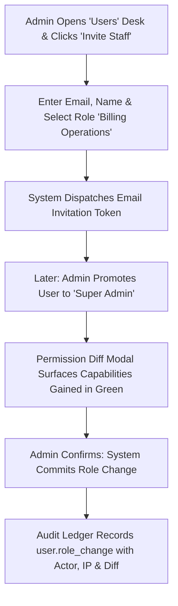

# Product Requirements Document (PRD)
## Sprint 7: Administration, RBAC, Keys & Audit Logging

---

### 1. Document Control & Metadata
- **Document Title:** Product Requirements Document - Sprint 7: Administration, RBAC, Keys & Audit Logging
- **Document Version:** 1.0.0
- **Status:** In Progress
- **Author:** CICOD Product & Architecture Team
- **Target Sprint:** Sprint 7 (Week 8)
- **Target Audience:** Chief Information Security Officer (CISO), Compliance Officers, System Administrators, Security Engineers
- **Reference Code:** [users/page.tsx](file:///c:/Users/CI-STAFF/Documents/CICOD%20TEST/Cicod%20CRM/src/app/crm/settings/users/page.tsx), [roles/page.tsx](file:///c:/Users/CI-STAFF/Documents/CICOD%20TEST/Cicod%20CRM/src/app/crm/settings/roles/page.tsx), [audit/page.tsx](file:///c:/Users/CI-STAFF/Documents/CICOD%20TEST/Cicod%20CRM/src/app/crm/settings/audit/page.tsx), [api-keys/page.tsx](file:///c:/Users/CI-STAFF/Documents/CICOD%20TEST/Cicod%20CRM/src/app/crm/settings/api-keys/page.tsx)
- **Last Updated:** 2026-10-13

---

### 2. Executive Summary & Core Deliverables
The legacy application suffered catastrophic governance vulnerabilities: 68 out of 70 staff members held unchecked "ADMIN" privileges, 58 accounts had been inactive for over 90 days with no deactivation mechanism, and user deletion was a permanent one-click risk. API keys were generated by typing arbitrary IDs into unauthenticated inputs and displayed in plain text without expiration or hash verification. Finally, live database connection strings were exposed in the front-end UI, and no centralized audit trail existed.

Sprint 7 delivers enterprise-grade security and administrative governance: granular **Role-Based Access Control (RBAC)**, safe **User Management** with a 90+ day stale account review, a secure **Merchant API Key Lifecycle** (hashed secrets shown once), and an immutable, append-only **System Audit Trail**.

#### Core Deliverables
1. **User Management Desk (`/crm/settings/users`):** Segment tabs for *Active*, *Not signed in 90+ days*, *Invited*, and *Deactivated*.
2. **Permission Diff Modal:** Visual side-by-side modal displaying capabilities gained (green) and lost (red) before role changes commit.
3. **Safe Soft-Deactivation:** Replaces dangerous hard delete with soft deactivation and mandatory reason tracking; blocks self-deactivation.
4. **RBAC Permission Matrix (`/crm/settings/roles`):** Pre-configured standard roles (`Super Admin`, `Billing Ops`, `Sales Rep`, `Support Agent`, `Read-Only`) and custom role builder.
5. **Secure API Key Lifecycle Studio (`/crm/settings/api-keys`):** Scoped issuance, one-time plaintext secret reveal modal, SHA-256 hashed storage, and safe key revocation.
6. **Immutable System Audit Ledger (`/crm/settings/audit`):** Append-only audit table logging Actor, IP, Action, Entity, and expandable before/after JSON diffs.
7. **Compliance CSV Export:** Filtered audit export engine supporting internal and external regulatory compliance reviews.

---

### 3. Product Vision & Strategic Objectives
- **Least-Privilege Enforcement:** Ensure staff members hold only the minimum necessary operational permissions required for their daily duties.
- **Credential Hygiene:** Eliminate unhashed API tokens and stale, unmonitored employee logins across the platform.
- **Forensic Traceability:** Maintain an immutable record of every critical system modification (price changes, suspensions, role reassignments).

---

### 4. Target Audience & User Personas
- **Chief Information Security Officer (CISO):** Audits administrative privilege distribution, monitors inactive users, and inspects credential lifecycles.
- **Compliance & Risk Auditor:** Queries historical change logs to verify regulatory compliance (NDPR, ISO 27001, SOC 2).
- **System Administrator:** Onboards new staff via email invitations, assigns roles, and rotates compromised integration keys.

---

### 5. Scope Boundaries

#### 5.1 In-Scope
- User directory with status segments and 90+ day stale account triage.
- Invitation workflow with time-limited token links.
- Role management matrix with module-level granular scopes (`View`, `Create`, `Edit`, `Suspend`, `Export`).
- Role change permission diff confirmation modal.
- Scoped merchant API key generation with one-time secret view.
- Append-only system audit log with JSON diff inspector and CSV exporter.

#### 5.2 Out-of-Scope
- Hardware security key (YubiKey / WebAuthn FIDO2) registration (scheduled for post-v2).
- Single Sign-On (SSO) SAML / Okta enterprise federations (mocked token flows in Sprint 7).
- Direct production database provisioning from UI (permanently removed for security).

---

### 6. Comprehensive User Flow & Journey Maps

#### 6.1 Primary Happy Path Flow


#### 6.2 Alternate & Exception Flows
- **Self-Deactivation Block:** A logged-in administrator attempts to click "Deactivate" on their own profile row. System disables the button and displays a warning tooltip: *"You cannot deactivate your own active session. Contact another administrator."*
- **Stale Account Review:** Security admin switches to "Not signed in 90+ days" tab. Selects 12 inactive accounts and clicks "Deactivate Stale Users". Accounts are soft-deactivated and their session tokens immediately invalidated.
- **Key Secret Dismissal:** Operator generates a new API key. Secret `ck_live_9a...` appears in a modal with warning: *"This token will never be shown again"*. Once closed, secret is permanently hidden and displayed as `••••ABCD`.

---

### 7. Functional Requirements (FRs)

#### 7.1 User Management & Stale Account Review
- **FR-7.1.1:** Must provide user segment tabs: *Active*, *Not signed in 90+ days*, *Invited*, and *Deactivated*.
- **FR-7.1.2:** "Invite User" modal must capture Work Email, Full Name, and Assigned Role, generating a secure token with 7-day expiration.
- **FR-7.1.3:** Changing a user's role must open a Permission Diff Modal showing added permissions (green) and removed permissions (red).
- **FR-7.1.4:** Deactivation must require a documented reason code ("Resigned", "Role change", "Suspicious activity") and block self-deactivation.

#### 7.2 Roles & Permissions Matrix
- **FR-7.2.1:** Must support standard built-in roles: `Super Admin`, `Billing Operations`, `Sales Representative`, `Support Agent`, and `Read-Only Viewer`.
- **FR-7.2.2:** Permissions matrix must control scopes across Modules: Customers, Billing, Catalogue, Growth, Messaging, and Settings.
- **FR-7.2.3:** Action verbs per module must include: `VIEW`, `CREATE`, `EDIT`, `SUSPEND_PUBLISH`, and `EXPORT`.

#### 7.3 Merchant API Key Lifecycle
- **FR-7.3.1:** Key generation must bind to a specific Merchant ID, descriptive label, and permission scope.
- **FR-7.3.2:** Plaintext secret must be generated via cryptographically secure random bytes, shown only once in modal, and saved as a SHA-256 hash.
- **FR-7.3.3:** Key directory must show masked key (`••••ABCD`), Creator, Created Date, Last Used timestamp, and Revoke action.
- **FR-7.3.4:** Revocation must immediately invalidate key authorization and record actor reason.

#### 7.4 System Audit Trail
- **FR-7.4.1:** Append-only table logging Timestamp (UTC), Actor (Name, Email, IP), Action Type, Target Entity, and Payload Diff.
- **FR-7.4.2:** Clicking an audit row must expand a visual JSON diff showing before-and-after attributes.
- **FR-7.4.3:** "Export Audit Log (CSV)" must generate a formatted compliance download matching active filters.

---

### 8. Non-Functional Requirements (NFRs)

#### 8.1 Performance & Latency
- Permission check middleware must evaluate staff capability tokens in `< 1ms` in memory.
- Audit table queries across 100,000+ historical events must return in `< 250ms` using indexed timestamps.

#### 8.2 Security & Compliance
- Cryptographic Hashing: API keys and passwords must use industry-standard hashing (SHA-256 for API tokens, bcrypt with work factor 12 for passwords).
- Append-Only Database Policy: The audit table connection must have revoked `UPDATE` and `DELETE` SQL permissions.

#### 8.3 Reliability & Availability
- Audit logging failures must not silently fail; critical security events must fail closed or trigger emergency log alerts.
- Stale account cron must run daily at 00:00 UTC without service interruption.

#### 8.4 Usability & Accessibility
- Permission diff modal must use clear symbols (+ and -) alongside colors for color-blind accessibility.
- Masked key strings must feature one-click copy buttons for convenient developer sharing.

---

### 9. Detailed User Stories & Acceptance Criteria

#### User Story 7.1: Visual Permission Diff
*As a Security Administrator, I want to see a before-and-after diff when changing a staff role, so that I do not grant excessive administrative rights by accident.*
- **AC-7.1.1:** Selecting a new role triggers a modal displaying green badges for newly granted capabilities and red badges for revoked capabilities.
- **AC-7.1.2:** Committing updates the user's role and logs the event to the audit trail.

#### User Story 7.2: One-Time API Key Generation
*As a Developer, I want to generate a secure merchant API key that is displayed once and hashed, so that leaked credentials cannot be extracted from database dumps.*
- **AC-7.2.1:** Key secret is displayed only in the initial generation modal.
- **AC-7.2.2:** Subsequent page loads display only the masked suffix `••••ABCD`.

#### User Story 7.3: Compliance Audit Log Inspection
*As a Compliance Officer, I want to filter audit logs by date and actor to inspect who suspended a customer, so that we satisfy regulatory accountability requirements.*
- **AC-7.3.1:** Filtering by action `customer.suspend` isolates all suspension events with operator names and timestamps.
- **AC-7.3.2:** Expanding the row reveals the reason entered by the operator.

---

### 10. Technical Architecture & Data Models

#### Governance Schemas
```typescript
export interface UserDTO {
  id: string;
  name: string;
  email: string;
  roleId: string;
  roleName: string;
  status: "ACTIVE" | "STALE_90D" | "INVITED" | "DEACTIVATED";
  lastLoginAt?: string;
  createdAt: string;
}

export interface RoleWithPermissionsDTO {
  id: string;
  name: string;
  description: string;
  isSystemLocked: boolean;
  permissions: Array<{
    module: "CUSTOMERS" | "BILLING" | "CATALOGUE" | "GROWTH" | "SETTINGS";
    actions: Array<"VIEW" | "CREATE" | "EDIT" | "SUSPEND_PUBLISH" | "EXPORT">;
  }>;
}

export interface ApiKeyDTO {
  id: string;
  merchantId: string;
  merchantName: string;
  label: string;
  maskedKey: string; // e.g. "••••992A"
  scope: "READ_ONLY" | "TRANSACTIONS" | "FULL_ACCESS";
  status: "ACTIVE" | "REVOKED";
  createdBy: string;
  createdAt: string;
  lastUsedAt?: string;
}

export interface AuditLogEntryDTO {
  id: string;
  timestamp: string;
  actor: {
    id: string;
    name: string;
    email: string;
    ipAddress: string;
  };
  action: string; // e.g. "customer.suspend", "plan.publish"
  targetEntity: {
    type: string;
    id: string;
    label: string;
  };
  diff?: {
    before: Record<string, unknown>;
    after: Record<string, unknown>;
  };
}
```

#### REST API Endpoints
| Method | Endpoint | Description | Status Codes |
|---|---|---|---|
| `GET` | `/api/v2/users` | List staff with login metadata and status | `200` |
| `POST` | `/api/v2/users/invite` | Send staff invitation email | `201`, `400` |
| `PATCH` | `/api/v2/users/{id}/role` | Update role with diff logging | `200`, `403` |
| `POST` | `/api/v2/users/{id}/deactivate` | Soft-deactivate staff account | `200`, `422` |
| `GET` | `/api/v2/roles` | Retrieve role permissions matrix | `200` |
| `POST` | `/api/v2/api-keys` | Generate scoped API key (returns secret once) | `201` |
| `POST` | `/api/v2/api-keys/{id}/revoke` | Revoke active merchant API key | `200` |
| `GET` | `/api/v2/audit-log` | Query immutable audit log records | `200` |
| `GET` | `/api/v2/audit-log/export` | Download audit entries as CSV | `200` |

---

### 11. Edge Cases & Error Handling Strategies
- **Attempted Self-Deactivation:** System rejects the API call with HTTP 422: *"Cannot deactivate current authenticated user"*.
- **Revoking Key with Active Traffic:** System alerts operator: *"This key handled 1,420 calls in the last 24 hours. Revoking will immediately reject further requests."*
- **Role Deletion While Assigned:** Deleting a custom role is blocked if any active staff member is currently assigned to it.

---

### 12. Success Metrics & Key Performance Indicators (KPIs)
- **Privilege Normalization:** 100% of non-admin staff migrated away from unrestricted "ADMIN" roles.
- **Stale Account Elimination:** 0 active accounts with no login activity in > 90 days.
- **Zero Raw Secret Breaches:** 100% of integration credentials hashed with salt at rest.
- **Audit Completeness:** 100% of administrative mutations accompanied by tamper-proof audit log entries.

---

### 13. Release Plan, Milestones & Rollout Strategy
- **Milestone 7.1 (Days 1–3):** User management desk with status segments, invite modal, and stale account filters.
- **Milestone 7.2 (Days 4–5):** Roles and permissions matrix with Permission Diff confirmation dialog.
- **Milestone 7.3 (Days 6–7):** Secure API Key generator with one-time display modal and revocation controls.
- **Milestone 7.4 (Days 8–10):** Append-only audit log viewer with JSON diff inspector and CSV exporter.

---

### 14. Open Questions, Risks & Dependencies
- **Risk:** Existing staff accustomed to shared passwords may resist individual user invitations.
  - *Mitigation:* Enforce individual work email requirement and disable generic shared credentials.
- **Dependency:** Reference data roles and permission models must align across all frontend feature guards.
- **Open Question:** How long should system audit logs be retained online?
  - *Resolution:* Audit logs remain queryable online for 365 days, followed by immutable cold-storage archival for 7 years.
