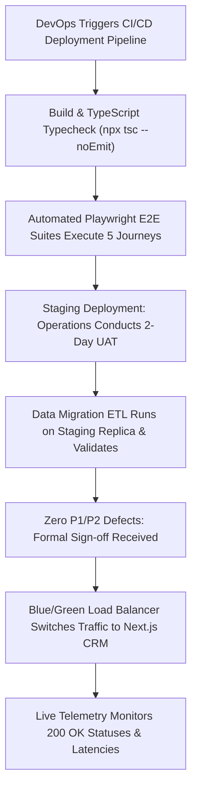

# Product Requirements Document (PRD)
## Sprint 8: Backend Integration, QA & Production Launch

---

### 1. Document Control & Metadata
- **Document Title:** Product Requirements Document - Sprint 8: Backend Integration, QA & Production Launch
- **Document Version:** 1.0.0
- **Status:** In Progress
- **Author:** CICOD Product & Architecture Team
- **Target Sprint:** Sprint 8 (Week 9)
- **Target Audience:** VP of Engineering, Lead DevOps / SRE, Head of QA, All Product & Operations Stakeholders
- **Reference Code:** [crawl_scripts/](file:///c:/Users/CI-STAFF/Documents/CICOD%20TEST/CRM/WorkerCrm/crawl_scripts/), [Prototype_Update_Guide.md](file:///c:/Users/CI-STAFF/Documents/CICOD%20TEST/CRM/WorkerCrm/Prototype_Update_Guide.md)
- **Last Updated:** 2026-10-13

---

### 2. Executive Summary & Core Deliverables
The legacy backend Java/Hibernate APIs suffered from leaky abstraction contracts (exposing internal ORM fields like `hibernateLazyInitializer`), inconsistent JSON keys across endpoints (`list`, `merchants`, `services`, `products`, `obj`, `queue`), and malformed URLs (`/crm//merchant/...`, `workorder/CICOD%20Number/23488`). Furthermore, the Next.js frontend prototype operates on mock in-memory state stores that reset on page reload, and legacy releases suffered from a complete absence of automated regression testing.

Sprint 8 transitions the CICOD CRM into a hardened production release: replacing mock state with a typed **Production REST Client Layer** (`@tanstack/react-query`), executing **5 Comprehensive Playwright E2E Test Suites**, running **Legacy Data Migration & E.164 Sanitization**, conducting **Staging UAT Sign-Off**, and executing a zero-downtime **Production DNS Cutover**.

#### Core Deliverables
1. **Typed Production API Client (`src/lib/api/`):** React Query / Server Actions layer with full TypeScript contract mapping, decoupled from raw SQL/ORM schemas.
2. **Transparent Authentication & Interceptors:** JWT session handling, Bearer token injection, automatic 401 refresh token retry, and session expiry redirects.
3. **Legacy Data Migration & Sanitization:** ETL pipeline migrating 13,355 merchants, normalising malformed telephone numbers to E.164 (`+234...`), and resolving expired dates into proper health states.
4. **Catalogue Deduplication:** Consolidation of legacy duplicate offers into clean versioned tiers, archiving 25 obsolete offers with 0 subscribers.
5. **Automated Playwright E2E Test Suites:** 5 full regression suites testing Customer Operations, Catalogue Pricing, Billing & Collections, Sales Conversion, and RBAC / API Keys.
6. **Operations UAT Sign-Off:** Structured staging review with Customer Operations and Finance leads with zero P1/P2 defects.
7. **Zero-Downtime Blue/Green Production Cutover:** Load balancer DNS cutover replacing the legacy Angular Metronic application.

---

### 3. Product Vision & Strategic Objectives
- **Zero In-Memory Volatility:** Ground all user interactions, filters, and mutations in durable, transactional PostgreSQL/REST persistence.
- **Flawless Quality Assurance:** Guard every deployment with automated end-to-end user journey tests to prevent regression leaks.
- **Smooth Operational Continuity:** Ensure zero downtime and zero lost customer records or billing transactions during final cutover.

---

### 4. Target Audience & User Personas
- **Lead DevOps / Site Reliability Engineer:** Manages containerized deployments, Kubernetes clusters, SSL certificates, and DNS switches.
- **QA Automation Lead:** Designs Playwright test scripts, tests cross-browser compatibility, and monitors CI/CD pass rates.
- **Head of Operations & Finance:** Validates real daily customer workflows, balances, and reports during staging UAT.

---

### 5. Scope Boundaries

#### 5.1 In-Scope
- Implementation of typed API clients in `src/lib/api/` replacing `src/lib/mock/`.
- JWT token refresh interceptor and global error boundaries.
- Database ETL migration scripts for 13,355 merchants, telephone normalization, and reference data seeding.
- Automated Playwright E2E suites for all 5 core user journeys.
- Staging environment deployment and structured UAT checklist.
- Blue/Green production DNS cutover.

#### 5.2 Out-of-Scope
- Complete rewrite of third-party external banking gateways (Paystack/Flutterwave/Stripe APIs are integrated via existing standards).
- Hardware server procurement (cloud container infrastructure utilized).
- Customer end-user self-service portal deployment (internal staff CRM focus).

---

### 6. Comprehensive User Flow & Journey Maps

#### 6.1 Primary Happy Path Flow


#### 6.2 Alternate & Exception Flows
- **E2E Test Failure Intercept:** If Journey 3 (Billing Offline Payment) fails due to a selector mismatch, CI/CD aborts deployment immediately; staging promotion is blocked until resolved.
- **Expired Refresh Token:** User leaves tab open overnight. The next morning, fetch interceptor attempts token refresh. Refresh token has expired. Interceptor safely clears auth state and redirects to `/crm/login?reason=session_expired`.
- **Migration Data Conflict:** During merchant ETL, a duplicate subdomain is encountered. Migration script flags the record in an exception CSV with auto-suffixed slug (`demo-legacy-1`) for manual review.

---

### 7. Functional Requirements (FRs)

#### 7.1 Production REST Client Layer
- **FR-8.1.1:** Must implement typed API client wrappers using `@tanstack/react-query` or Next.js Server Actions with TypeScript response definitions.
- **FR-8.1.2:** HTTP interceptor must inject `Authorization: Bearer <token>` on all outbound API requests.
- **FR-8.1.3:** On receiving HTTP 401 Unauthorized, interceptor must hold queue, request `/api/v2/auth/refresh`, and replay original request transparently.
- **FR-8.1.4:** Global React Error Boundaries must catch unhandled component crashes and present user-friendly error recovery screens with unique Correlation IDs.

#### 7.2 Data Migration & Sanitization
- **FR-8.2.1:** Migration pipeline must migrate 13,355 merchant records from legacy MySQL tables to target PostgreSQL schema.
- **FR-8.2.2:** Phone sanitizer must parse all phone numbers, strip non-numeric characters and local leading zeroes, and enforce international E.164 formatting (`+234...`).
- **FR-8.2.3:** Obsolete catalogue tiers with zero subscribers must be migrated directly to `Archived` status.
- **FR-8.2.4:** Reference data seeder must insert official 36 Nigerian States, 774 LGAs, curated countries, and base currencies (NGN, USD, GBP).

#### 7.3 Automated Playwright E2E Suites
- **FR-8.3.1 (Journey 1 - Customer Operations):** Search by CICOD ID → Open Customer 360 → Add operator note → Verify timeline appearance.
- **FR-8.3.2 (Journey 2 - Catalogue & Pricing):** Create plan → Assign features → Autofill 10x annual prices → Verify live preview → Publish.
- **FR-8.3.3 (Journey 3 - Billing & Collections):** Filter failed payments → Inspect attempt drawer → Record offline payment with teller ref → Verify debt cleared.
- **FR-8.3.4 (Journey 4 - Sales Pipeline Conversion):** Drag Kanban lead → Click "Convert to Customer" → Complete wizard → Verify linked customer.
- **FR-8.3.5 (Journey 5 - RBAC & API Keys):** Generate API key → Verify secret shown once → Revoke key → Verify immutable audit log entry.

#### 7.4 Staging UAT & Production Cutover
- **FR-8.4.1:** Structured 2-day UAT sign-off with operations leads; all test cases must pass with 0 P1/P2 defects.
- **FR-8.4.2:** Load balancer DNS cutover executing zero-downtime routing switchover to the new Next.js CRM.

---

### 8. Non-Functional Requirements (NFRs)

#### 8.1 Performance & Latency
- 95th percentile (p95) API response time must remain `< 200ms` across all listing endpoints under 150 concurrent staff users.
- Initial page bundle load time must remain `< 1.2 seconds` over 4G connections.

#### 8.2 Security & Compliance
- HTTPS enforcement: Strict-Transport-Security (HSTS), TLS 1.3, and CSP headers configured on all responses.
- Database credentials and API secrets stored exclusively in AWS Secrets Manager / Azure Key Vault; zero secrets in Git repositories.

#### 8.3 Reliability & Availability
- 99.9% uptime SLA for the production CRM console.
- Disaster recovery: Automated daily database snapshots with Point-in-Time Recovery (PITR) enabling RPO < 1 hour and RTO < 15 minutes.

#### 8.4 Usability & Accessibility
- Complete responsive compatibility across desktop browsers (Chrome, Edge, Firefox, Safari) at 1280px, 1440px, and 1920px viewports.
- Keyboard focus trapping on all modals and drawers.

---

### 9. Detailed User Stories & Acceptance Criteria

#### User Story 8.1: Transparent Session Refresh
*As an Operations Specialist, I want my session to refresh silently in the background while I enter customer notes, so that my work is never interrupted by random login prompts.*
- **AC-8.1.1:** Expired access token triggers automated refresh token call in `< 200ms`.
- **AC-8.1.2:** Active form state and typed text remain intact without page reload.

#### User Story 8.2: Automated Regression Protection
*As a Lead Engineer, I want the full Playwright suite to run on every pull request, so that regressions in billing or customer search are caught before reaching production.*
- **AC-8.2.1:** All 5 core journey test suites run headlessly in CI pipeline.
- **AC-8.2.2:** Pull request is blocked from merging if any test step fails.

#### User Story 8.3: Zero-Downtime DNS Cutover
*As a DevOps Architect, I want to route traffic to the new CRM cluster using a blue/green cutover, so that active customer onboarding and transactions suffer zero downtime.*
- **AC-8.3.1:** Load balancer switches traffic instantly upon health check validation.
- **AC-8.3.2:** Legacy Angular application traffic drops to 0 without HTTP 502/504 errors.

---

### 10. Technical Architecture & Data Models

#### CI/CD & Deployment Architecture
```
Production CI/CD Pipeline:
├── 1. Static Verification: npx eslint src && npx tsc --noEmit
├── 2. Unit Testing: Vitest / Jest Component Tests
├── 3. E2E Testing: Playwright (5 Core Journey Suites)
├── 4. Docker Container Build & Trivy Vulnerability Scan
├── 5. Deploy to Staging Cluster (Kubernetes / AWS ECS)
├── 6. Operations UAT Review & Database Replica Validation
└── 7. Production Cutover: Blue/Green ALB Traffic Switch
```

#### Health & Telemetry Endpoints
| Endpoint | Method | Purpose | Response |
|---|---|---|---|
| `/api/v2/health` | `GET` | Container liveness & database connectivity check | `{ status: "ok", db: "connected", redis: "healthy" }` |
| `/api/v2/metrics` | `GET` | Prometheus scraping endpoint for latencies | OpenMetrics formatted data |

---

### 11. Edge Cases & Error Handling Strategies
- **Database Connection Pool Exhaustion:** Automatic connection retry with exponential backoff and circuit breaker to prevent cascading failures.
- **Malformed Legacy Telephone Numbers:** Regex validator routes invalid numbers that cannot be salvaged into an exception review table.
- **Concurrent API Deployments:** Backward-compatible API versioning (`/api/v2/`) ensures client instances continue functioning during deployment transitions.

---

### 12. Success Metrics & Key Performance Indicators (KPIs)
- **E2E Test Coverage:** 100% pass rate across all 5 core operational journeys.
- **Migration Data Fidelity:** 100% of 13,355 customer records successfully migrated with zero data corruption.
- **Production Cutover Downtime:** 0 minutes downtime during DNS transition.
- **Post-Launch Defect Rate:** 0 P1 (critical severity) defects reported within 30 days of launch.

---

### 13. Release Plan, Milestones & Rollout Strategy
- **Milestone 8.1 (Days 1–3):** Implement typed REST client layer and JWT refresh token interceptor.
- **Milestone 8.2 (Days 4–5):** Run database migration scripts, telephone sanitization, and reference data seeding.
- **Milestone 8.3 (Days 6–8):** Execute Playwright automated test suites across all 5 core journeys in CI.
- **Milestone 8.4 (Days 9–10):** Conduct 2-day Staging UAT, obtain stakeholder sign-offs, and execute zero-downtime production cutover.

---

### 14. Open Questions, Risks & Dependencies
- **Risk:** Unexpected schema differences in legacy MySQL database dumps.
  - *Mitigation:* Execute dry-run migration scripts on a staging replica 1 week prior to final cutover.
- **Dependency:** Backend team must deploy all v2 REST endpoints to staging environment prior to Sprint 8 Day 1.
- **Open Question:** Should legacy Angular Metronic application remain accessible as a read-only fallback?
  - *Resolution:* Yes, preserve read-only legacy access at `legacy-crm.cicod.com` for 30 days post-cutover before decommissioning.
